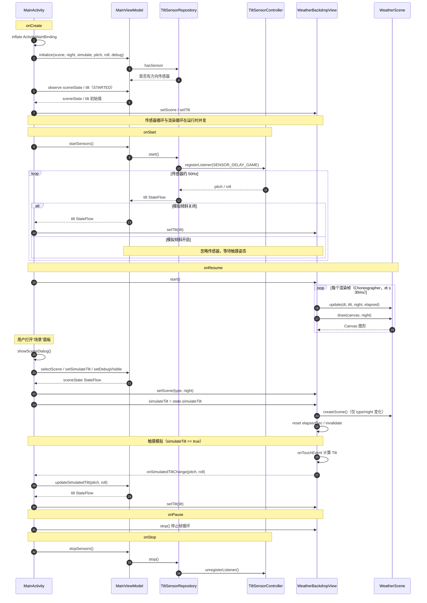

# HydrogenOS10 风格天气动态背景复刻 Demo（非官方）

> 这段动画来自我使用过的 OnePlus 7 Pro（GM1901），系统为 Android 10 / Hydrogen OS 10.0.10.GM21。这个版本内置的天气应用动画非常出色，色彩层次、光影和随手机倾斜的视差都做得很极致。为了还原这个效果，我用 Android 原生 View + Canvas 做了一次非官方的复刻与模拟，向这个出色的系统应用致敬。

在传统 XML + 自定义 View 的 Android 工程里，参考氢气OS10 风格天气应用的晴天主页视觉效果，用纯 `Canvas` 程序化绘制做一个非官方模拟 Demo，并扩展到多云、阴天、雾、霾、沙尘暴、雨、雷雨、雪、冰雹等场景。

所有画面均由 `Canvas` 程序化绘制，**不联网、不申请权限、不包含原应用的代码、图片、字体、图标或其他素材，不依赖第三方动画库**。

> **免责声明**：本项目为非官方、非商业的学习与效果演示，仅对天气动画的视觉表现做复刻 / 模拟，与 OnePlus、Hydrogen OS 及相关天气应用无任何关联，也未获得其授权或背书；相关名称、商标及原应用素材归其权利人所有。请勿将本项目用于商业用途。

## 场景录屏

单个场景约 1~3.5MB。点击链接会打开 raw 视频文件，浏览器可能直接播放或触发下载；GitHub 不支持在 README 中内嵌 MP4。

| 场景 | 日间录屏 | 夜间录屏 |
| --- | --- | --- |
| 晴天 | [日间](https://github.com/SiXuManYan/hydrogen-weather-animation/raw/main/docs/scenes/sunny_day.mp4) | [夜间](https://github.com/SiXuManYan/hydrogen-weather-animation/raw/main/docs/scenes/sunny_night.mp4) |
| 多云 | [日间](https://github.com/SiXuManYan/hydrogen-weather-animation/raw/main/docs/scenes/cloudy_day.mp4) | [夜间](https://github.com/SiXuManYan/hydrogen-weather-animation/raw/main/docs/scenes/cloudy_night.mp4) |
| 阴天 | [日间](https://github.com/SiXuManYan/hydrogen-weather-animation/raw/main/docs/scenes/overcast_day.mp4) | [夜间](https://github.com/SiXuManYan/hydrogen-weather-animation/raw/main/docs/scenes/overcast_night.mp4) |
| 雾 | [日间](https://github.com/SiXuManYan/hydrogen-weather-animation/raw/main/docs/scenes/fog_day.mp4) | [夜间](https://github.com/SiXuManYan/hydrogen-weather-animation/raw/main/docs/scenes/fog_night.mp4) |
| 霾 | [日间](https://github.com/SiXuManYan/hydrogen-weather-animation/raw/main/docs/scenes/haze_day.mp4) | [夜间](https://github.com/SiXuManYan/hydrogen-weather-animation/raw/main/docs/scenes/haze_night.mp4) |
| 沙尘暴 | [日间](https://github.com/SiXuManYan/hydrogen-weather-animation/raw/main/docs/scenes/sandstorm_day.mp4) | [夜间](https://github.com/SiXuManYan/hydrogen-weather-animation/raw/main/docs/scenes/sandstorm_night.mp4) |
| 小雨 | [日间](https://github.com/SiXuManYan/hydrogen-weather-animation/raw/main/docs/scenes/light_rain_day.mp4) | [夜间](https://github.com/SiXuManYan/hydrogen-weather-animation/raw/main/docs/scenes/light_rain_night.mp4) |
| 中雨 | [日间](https://github.com/SiXuManYan/hydrogen-weather-animation/raw/main/docs/scenes/rain_day.mp4) | [夜间](https://github.com/SiXuManYan/hydrogen-weather-animation/raw/main/docs/scenes/rain_night.mp4) |
| 大雨 | [日间](https://github.com/SiXuManYan/hydrogen-weather-animation/raw/main/docs/scenes/heavy_rain_day.mp4) | [夜间](https://github.com/SiXuManYan/hydrogen-weather-animation/raw/main/docs/scenes/heavy_rain_night.mp4) |
| 暴雨 | [日间](https://github.com/SiXuManYan/hydrogen-weather-animation/raw/main/docs/scenes/storm_day.mp4) | [夜间](https://github.com/SiXuManYan/hydrogen-weather-animation/raw/main/docs/scenes/storm_night.mp4) |
| 雷阵雨 | [日间](https://github.com/SiXuManYan/hydrogen-weather-animation/raw/main/docs/scenes/thunder_day.mp4) | [夜间](https://github.com/SiXuManYan/hydrogen-weather-animation/raw/main/docs/scenes/thunder_night.mp4) |
| 雨夹雪 | [日间](https://github.com/SiXuManYan/hydrogen-weather-animation/raw/main/docs/scenes/sleet_day.mp4) | [夜间](https://github.com/SiXuManYan/hydrogen-weather-animation/raw/main/docs/scenes/sleet_night.mp4) |
| 小雪 | [日间](https://github.com/SiXuManYan/hydrogen-weather-animation/raw/main/docs/scenes/light_snow_day.mp4) | [夜间](https://github.com/SiXuManYan/hydrogen-weather-animation/raw/main/docs/scenes/light_snow_night.mp4) |
| 大雪 | [日间](https://github.com/SiXuManYan/hydrogen-weather-animation/raw/main/docs/scenes/snow_day.mp4) | [夜间](https://github.com/SiXuManYan/hydrogen-weather-animation/raw/main/docs/scenes/snow_night.mp4) |
| 冰雹 | [日间](https://github.com/SiXuManYan/hydrogen-weather-animation/raw/main/docs/scenes/hail_day.mp4) | [夜间](https://github.com/SiXuManYan/hydrogen-weather-animation/raw/main/docs/scenes/hail_night.mp4) |

> 目前共 30 段场景录屏，覆盖全部 15 个场景。

---

## 1. 运行环境

| 项目 | 要求 |
| --- | --- |
| Android Studio | 2026.1+（当前工程使用 AGP 9.3.3 / Gradle 9.5） |
| JDK | 21+ |
| compileSdk / targetSdk | 37 |
| minSdk | 29 |
| 屏幕方向 | 竖屏锁定 |
| 权限 | 无 |

---

## 2. 运行方式

### Android Studio

1. `File → Open` 选择你克隆或解压后的项目根目录（包含 `settings.gradle.kts` 的目录）。
2. 等待 Gradle Sync 完成（首次需要联网下载依赖）。
3. 选择 `app` 运行配置，点击 Run。

### 命令行

```bash
# Windows / Git Bash
./gradlew assembleDebug

adb install -r app/build/outputs/apk/debug/app-debug.apk
adb shell am start -n com.sugar.weather/.MainActivity
```

生成的 APK 位于：

```
app/build/outputs/apk/debug/app-debug.apk
```

---

## 3. 操作说明

- **倾斜手机**：左右横滚（roll）驱动场景横向视差；前后俯仰（pitch）驱动纵向移动与轻微缩放。
- **右下角「场景」按钮**：打开场景面板，可切换天气、日间/夜间、触摸模拟、调试信息。
- **触摸模拟倾斜**：
  - 关闭时使用真实方向传感器；
  - 打开后可用手指拖动模拟倾斜（无方向传感器的设备会自动打开）；
  - 左右拖动改变横滚，上下拖动改变俯仰。
- **重置视角**：把模拟角度恢复到竖直握持状态（pitch = 90°，roll = 0°）。
- **显示俯仰 / 横滚**：左上角显示实时 `pitch`、`roll`，以及数据来源（传感器 / 模拟）。

> 如果倾斜手机没有反应，先检查「触摸模拟倾斜」是否被打开；打开时会覆盖真实传感器数据。

---

## 4. 支持的场景

| SceneType | 中文 | 实现方式 |
| --- | --- | --- |
| `SUNNY` | 晴天 | 8 层多边形光晕 + 4 个六边形云；夜间切换为流星弧线 |
| `CLOUDY` | 多云 | 9 个半透明圆形云团 + 太阳；夜间增加星点 |
| `OVERCAST` | 阴天 | 同多云，使用灰蓝色云团色板 |
| `FOG` | 雾 | 24 个线性渐变圆，缓慢漂移、旋转、叠加 |
| `HAZE` | 霾 | 大量半透明黄褐色颗粒漂移、闪烁 |
| `SANDSTORM` | 沙尘暴 | 暖色渐变 + 沙尘团 + 高速横向沙粒 |
| `LIGHT_RAIN` | 小雨 | 雨滴线段粒子 |
| `RAIN` | 中雨 | 密度、速度、线宽更高的雨滴粒子 |
| `HEAVY_RAIN` | 大雨 | 更密集的雨滴粒子 |
| `STORM` | 暴雨 | 最高密度的雨滴粒子 |
| `THUNDER` | 雷阵雨 | 雨滴粒子 + 随机闪电闪光 |
| `SLEET` | 雨夹雪 | 小雨 + 小雪叠加 |
| `LIGHT_SNOW` | 小雪 | 少量雪花（圆点 / 六边形） |
| `SNOW` | 大雪 | 密集雪花 |
| `HAIL` | 冰雹 | 雨滴 + 白色冰雹颗粒 |

夜间模式为手动切换，主要影响背景色板、云层配色、星点和晴天夜间流星效果。

---

## 5. 直接启动指定场景（方便截图 / 验收）

`MainActivity` 支持以下 Intent extra：

| key | 类型 | 说明 |
| --- | --- | --- |
| `scene` | String | `SceneType` 名称，如 `SUNNY`、`RAIN`、`SNOW` |
| `night` | boolean | 是否夜间 |
| `simulate` | boolean | 是否启用触摸模拟 |
| `pitch` | float | 模拟俯仰角（配合 `simulate=true`） |
| `roll` | float | 模拟横滚角（配合 `simulate=true`） |
| `debug` | boolean | 是否显示左上角调试信息 |

示例：

```bash
# 晴天日间，模拟竖直握持
adb shell am start -n com.sugar.weather/.MainActivity \
  --es scene SUNNY --ez night false --ez simulate true --ef pitch 90 --ef roll 0

# 雷阵雨夜间
adb shell am start -n com.sugar.weather/.MainActivity \
  --es scene THUNDER --ez night true

# 打开调试数值
adb shell am start -n com.sugar.weather/.MainActivity \
  --es scene SUNNY --ez debug true
```

> 同一个 Activity 已在运行时，使用 `am start` 可能只把旧实例带到前台。需要在多次截图之间切换场景时，先执行 `adb shell am force-stop com.sugar.weather`，或用系统「返回」退出后再启动。

---

## 6. 代码结构

```
app/src/main/java/com/sugar/weather/
├── MainActivity.kt                 # ViewBinding、StateFlow 收集、场景面板
├── ui/
│   ├── MainViewModel.kt            # MVVM 状态与动作
│   └── SceneUiState.kt             # 场景 / 昼夜 / 模拟 / 调试状态
├── data/
│   └── TiltSensorRepository.kt     # 方向传感器 → StateFlow
├── sensor/
│   └── TiltSensorController.kt     # TYPE_ORIENTATION / TYPE_ROTATION_VECTOR 封装
├── view/
│   └── WeatherBackdropView.kt      # 纯 Canvas 渲染 + Choreographer + 触摸姿态回调
└── scene/
    ├── WeatherScene.kt            # 场景接口
    ├── SceneType.kt               # 场景枚举 + 背景色 + 场景工厂
    ├── Tilt.kt                    # 设备姿态数据
    ├── SunnyScene.kt              # 晴天（日/夜）
    ├── SunnySceneConfig.kt        # 晴天全部可调参数
    ├── CloudScene.kt              # 多云 / 阴天
    ├── FogScene.kt                # 雾
    ├── HazeScene.kt               # 霾
    ├── SandstormScene.kt          # 沙尘暴
    ├── RainScene.kt               # 雨 / 雷雨 / 冰雹
    ├── SnowScene.kt               # 雪
    └── CompositeScene.kt          # 叠加场景（雨夹雪）

app/src/main/res/
├── layout/activity_main.xml       # 全屏背景 + 调试信息 + 右下角场景按钮
├── layout/dialog_scene_picker.xml # 场景选择面板
└── values/themes.xml              # 无 ActionBar、透明系统栏
```

---

## 7. 实现方式与关键逻辑

### 7.1 总体技术方案

- **架构**：ViewBinding + MVVM。`MainViewModel` 持有场景 / 昼夜 / 模拟 / 调试的 `StateFlow`，`TiltSensorRepository` 把传感器事件转成 `StateFlow`；`MainActivity` 只做布局绑定与事件转发，`WeatherBackdropView` 只负责 Canvas 渲染。
- **数据流**：`TiltSensorRepository → MainViewModel → MainActivity → WeatherBackdropView`。
- **核心绘制**：Kotlin + XML + ViewBinding + 自定义 `View`，所有天气场景直接绘制在 `Canvas` 上；没有使用 Compose、Lottie、视频或第三方动画库。
- **旋转**：不是属性动画，而是每个光晕层、云朵、雪花或弧线自己维护角度累加器：
  `angle += speed × dt`，绘制时通过 `Canvas.rotate()`、`Canvas.scale()`、`Canvas.drawArc()` 体现。
  每帧的 `dt` 来自 `Choreographer`，上限 30ms。
- **颜色呼吸**：在起始色和结束色之间做三角波插值，`colorT` 在 0~1 之间往返，而不是随机变色。
- **倾斜视差**：`TYPE_ORIENTATION` 提供 `pitch/roll`，映射为全局横纵位移，再叠加每层的深度系数。
- **性能**：`Paint`、`Path`、`RectF` 和顶点数组全部复用，`onDraw` 内不创建新对象。

### 7.2 晴天光晕

- 8 层光晕，每层是一个 12 边形（最内 3 层为 10 边形）。
- 每层不是直接画多边形填充，而是取 12 个顶点的相邻两点中点，与对边中点连线，共画 6 条穿过圆心的粗线；线宽等于相邻顶点距离，叠加后形成带凹角的色带效果。
- 半径按参考视觉比例缩放：

  ```text
  radiusPx = radiusDp × density × floor(density × 5 / 3)
  ```

- 每层独立自转、颜色在起始色与结束色之间缓慢往返；六边形云以 150/255 的最大透明度叠加。
- 太阳中心位于屏幕上方，初始时最外圈光晕下沿落在屏幕约 1/3 处，适配不同屏幕比例。

### 7.3 夜间晴天

夜间不使用光晕，而是 23 条大圆弧组成的流星/光带：圆心位于屏幕左上方较远处，半径和线宽各不相同，其中一部分缓慢旋转。背景切换为 `#051325`。

### 7.4 倾斜 → 视差

- 横向：`globalH = 266.7dp × roll / 90°`；每层再叠加 `depthPx × globalH / 1000`。
- 纵向：以竖直握持为中性（pitch = 90°），俯仰变化驱动太阳上下移动。
- 平滑：以最大约 900dp/s 追踪目标，距离目标小于 133dp 时按比例减速，避免抖动和瞬移。
- 帧间隔上限 30ms，防止切后台回来时跳变。

### 7.5 传感器

- 优先注册 `TYPE_ORIENTATION`（`SENSOR_DELAY_GAME`，约 50Hz）。
- 没有时回退 `TYPE_ROTATION_VECTOR`，通过旋转矩阵换算 pitch / roll。
- `MainActivity` 在 `onStart/onStop` 调用 `MainViewModel.startSensors/stopSensors`；`MainViewModel.onCleared` 也会兜底停止，避免泄漏。
- 完全静止时场景仍会自转、颜色呼吸、云层缩放，不依赖传感器持续变化。

### 7.6 渲染

- `Choreographer` 驱动，按真实帧间隔更新，目标 60fps。
- 绘制路径、Paint、Path、RectF、顶点数组全部复用；`onDraw` 内不创建新对象。
- 帧循环保留在 `WeatherBackdropView` 内，不经过 ViewModel，避免高频姿态更新触发整页 UI 刷新。
- 多云 / 阴天 / 雾等场景用 `Canvas` 实现；雨雪场景也统一使用 `Canvas` 粒子，以保持零依赖和易调参。

### 7.7 运行时序图

下图按当前实现绘制，重点区分两条高频数据流：传感器姿态和渲染帧循环。实线表示直接调用，虚线表示 StateFlow 发射或回调。



Activity 只负责 ViewBinding 绑定和事件转发；`WeatherBackdropView` 不直接访问 `SensorManager`，传感器生命周期和 UI 状态都由 `MainViewModel` / `TiltSensorRepository` 管理。

---

## 8. 调参入口

| 想改什么 | 修改位置 |
| --- | --- |
| 晴天光晕半径、旋转速度、颜色、深度、夜间弧线 | `SunnySceneConfig.kt` |
| 晴天云朵大小 / 位置 / 透明度 | `SunnySceneConfig.kt` 的 `CLOUD_*` |
| 晴天视差范围、平滑速度 | `SunnySceneConfig.kt` 的 `HORIZONTAL_RANGE_DP`、`FOLLOW_*` |
| 各天气的背景色 | `SceneType.kt` |
| 多云 / 阴天云团参数 | `CloudScene.kt` 的 `init` 表 |
| 雨量、速度、线宽、冰雹 | `RainScene.kt` 的 `Intensity` 配置块 |
| 雪量、雪花大小、数量 | `SnowScene.kt` 的 `count` 与 `init` |
| 霾 / 沙尘颗粒密度 | `HazeScene.kt`、`SandstormScene.kt` 的 `COUNT` |

---

## 9. 常见问题

### 9.1 手机倾斜没有反应

- 打开场景面板，确认「触摸模拟倾斜」已关闭；
- 打开调试信息，观察 `pitch` / `roll` 是否变化；
- 部分设备没有 `TYPE_ORIENTATION` 时，会回退到旋转矢量传感器；
- 模拟器没有真实姿态变化，请使用触摸模拟。

### 9.2 切换场景后还是旧场景

通过 adb 多次 `am start` 启动同一 Activity 时，系统可能复用旧实例。先 `adb shell am force-stop com.sugar.weather` 再启动，或在 App 内用场景面板切换。

### 9.3 画面构图和参考图略有差异

光晕半径按屏幕密度缩放；不同分辨率 / 显示缩放下，色带覆盖屏幕的比例会略有不同。已在 `SunnyScene.kt` 中按「最外圈下沿约在 1/3 屏高」做了归一化，可通过 `initialVertical` 一行微调。

---

## 10. 已知范围

- 只做动态背景，不包含城市、温度、小时预报、六日预报等 UI。
- 不接入任何天气数据 / 定位 / 网络。
- 晴天场景按参考截图做了较完整的视觉模拟；其余场景为基于同类天气效果的程序化近似实现。
- 夜间模式为手动切换，不读取系统深色模式。

---

## 11. 版权与免责声明

- 本项目是独立实现的学习 / 演示项目，仅以程序化绘制方式复刻、模拟天气动画的视觉表现。
- 项目不包含任何原应用的代码、图片、字体、图标或其他素材，也未获得相关权利人的授权、合作或背书。
- OnePlus、Hydrogen OS 等产品名称、系统名称和商标仅用于说明参考设备与参考对象，归各自权利人所有。
- 本项目不授予任何商业使用许可；如需商用，请自行确认并取得相关权利人的许可。
- 若相关权利人认为本项目存在不当之处，可通过仓库 Issue 联系作者处理。
