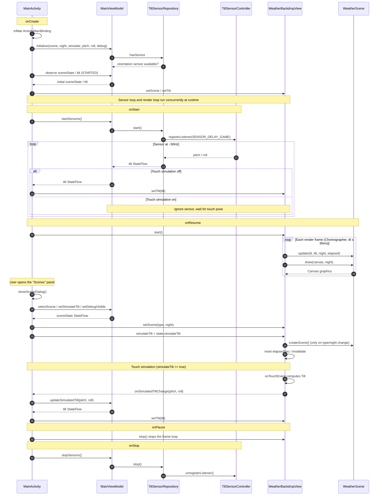

# HydrogenOS 10 Style Weather Dynamic Background Recreation Demo (Unofficial)

[](README.zh-CN.md)

> This animation comes from the OnePlus 7 Pro (GM1901) I used, running Android 10 / Hydrogen OS 10.0.10.GM21. The weather app built into that version had a stunning animation: the color layering, light and shadow, and the parallax that follows the phone's tilt were all pushed to the limit. To recreate that effect, I built an unofficial recreation and simulation using native Android View + Canvas, as a tribute to this excellent system app.

In a traditional XML + custom View Android project, this unofficial demo recreates the sunny home screen of a Hydrogen OS 10 style weather app with pure programmatic `Canvas` drawing, and extends it to cloudy, overcast, fog, haze, sandstorm, rain, thunderstorm, snow, hail and other scenes.

Every frame is drawn programmatically with `Canvas`. The project is **offline, requests no permissions, contains no code, images, fonts, icons or other assets from the original app, and depends on no third-party animation libraries**.

> **Disclaimer**: This is an unofficial, non-commercial project for learning and visual demonstration. It only recreates / simulates the visual appearance of the weather animations. It is not affiliated with, authorized by, or endorsed by OnePlus, Hydrogen OS, or the related weather app. All related names, trademarks and original app assets belong to their respective owners. Do not use this project for commercial purposes.

## Scene Recordings

Each clip is about 1–3.5 MB. Clicking a link opens the raw video file; the browser may play it inline or start a download. GitHub does not support embedding MP4 files in a README.

| Scene | Day recording | Night recording |
| --- | --- | --- |
| Sunny | [Day](https://github.com/SiXuManYan/hydrogen-weather-animation/raw/main/docs/scenes/sunny_day.mp4) | [Night](https://github.com/SiXuManYan/hydrogen-weather-animation/raw/main/docs/scenes/sunny_night.mp4) |
| Cloudy | [Day](https://github.com/SiXuManYan/hydrogen-weather-animation/raw/main/docs/scenes/cloudy_day.mp4) | [Night](https://github.com/SiXuManYan/hydrogen-weather-animation/raw/main/docs/scenes/cloudy_night.mp4) |
| Overcast | [Day](https://github.com/SiXuManYan/hydrogen-weather-animation/raw/main/docs/scenes/overcast_day.mp4) | [Night](https://github.com/SiXuManYan/hydrogen-weather-animation/raw/main/docs/scenes/overcast_night.mp4) |
| Fog | [Day](https://github.com/SiXuManYan/hydrogen-weather-animation/raw/main/docs/scenes/fog_day.mp4) | [Night](https://github.com/SiXuManYan/hydrogen-weather-animation/raw/main/docs/scenes/fog_night.mp4) |
| Haze | [Day](https://github.com/SiXuManYan/hydrogen-weather-animation/raw/main/docs/scenes/haze_day.mp4) | [Night](https://github.com/SiXuManYan/hydrogen-weather-animation/raw/main/docs/scenes/haze_night.mp4) |
| Sandstorm | [Day](https://github.com/SiXuManYan/hydrogen-weather-animation/raw/main/docs/scenes/sandstorm_day.mp4) | [Night](https://github.com/SiXuManYan/hydrogen-weather-animation/raw/main/docs/scenes/sandstorm_night.mp4) |
| Light rain | [Day](https://github.com/SiXuManYan/hydrogen-weather-animation/raw/main/docs/scenes/light_rain_day.mp4) | [Night](https://github.com/SiXuManYan/hydrogen-weather-animation/raw/main/docs/scenes/light_rain_night.mp4) |
| Moderate rain | [Day](https://github.com/SiXuManYan/hydrogen-weather-animation/raw/main/docs/scenes/rain_day.mp4) | [Night](https://github.com/SiXuManYan/hydrogen-weather-animation/raw/main/docs/scenes/rain_night.mp4) |
| Heavy rain | [Day](https://github.com/SiXuManYan/hydrogen-weather-animation/raw/main/docs/scenes/heavy_rain_day.mp4) | [Night](https://github.com/SiXuManYan/hydrogen-weather-animation/raw/main/docs/scenes/heavy_rain_night.mp4) |
| Rainstorm | [Day](https://github.com/SiXuManYan/hydrogen-weather-animation/raw/main/docs/scenes/storm_day.mp4) | [Night](https://github.com/SiXuManYan/hydrogen-weather-animation/raw/main/docs/scenes/storm_night.mp4) |
| Thunderstorm | [Day](https://github.com/SiXuManYan/hydrogen-weather-animation/raw/main/docs/scenes/thunder_day.mp4) | [Night](https://github.com/SiXuManYan/hydrogen-weather-animation/raw/main/docs/scenes/thunder_night.mp4) |
| Sleet | [Day](https://github.com/SiXuManYan/hydrogen-weather-animation/raw/main/docs/scenes/sleet_day.mp4) | [Night](https://github.com/SiXuManYan/hydrogen-weather-animation/raw/main/docs/scenes/sleet_night.mp4) |
| Light snow | [Day](https://github.com/SiXuManYan/hydrogen-weather-animation/raw/main/docs/scenes/light_snow_day.mp4) | [Night](https://github.com/SiXuManYan/hydrogen-weather-animation/raw/main/docs/scenes/light_snow_night.mp4) |
| Heavy snow | [Day](https://github.com/SiXuManYan/hydrogen-weather-animation/raw/main/docs/scenes/snow_day.mp4) | [Night](https://github.com/SiXuManYan/hydrogen-weather-animation/raw/main/docs/scenes/snow_night.mp4) |
| Hail | [Day](https://github.com/SiXuManYan/hydrogen-weather-animation/raw/main/docs/scenes/hail_day.mp4) | [Night](https://github.com/SiXuManYan/hydrogen-weather-animation/raw/main/docs/scenes/hail_night.mp4) |

> There are currently 30 scene recordings covering all 15 scenes.

---

## 1. Requirements

| Item | Requirement |
| --- | --- |
| Android Studio | 2026.1+ (this project uses AGP 9.3.3 / Gradle 9.5) |
| JDK | 21+ |
| compileSdk / targetSdk | 37 |
| minSdk | 29 |
| Screen orientation | Locked to portrait |
| Permissions | None |

---

## 2. How to Run

### Android Studio

1. `File → Open` and select the project root directory you cloned or extracted (the directory containing `settings.gradle.kts`).
2. Wait for Gradle Sync to finish (the first sync needs network access to download dependencies).
3. Select the `app` run configuration and click Run.

### Command Line

```bash
# Windows / Git Bash
./gradlew assembleDebug

adb install -r app/build/outputs/apk/debug/app-debug.apk
adb shell am start -n com.sugar.weather/.MainActivity
```

The generated APK is located at:

```
app/build/outputs/apk/debug/app-debug.apk
```

---

## 3. Controls

- **Tilt the phone**: left/right roll drives the horizontal parallax of the scene; front/back pitch drives vertical movement and slight scaling.
- **"Scenes" button at the bottom right**: opens the scene panel to switch weather, day/night, touch simulation and debug info.
- **Touch-simulated tilt**:
  - When off, the real orientation sensor is used;
  - When on, drag with a finger to simulate tilt (automatically enabled on devices without an orientation sensor);
  - Drag left/right to change roll, drag up/down to change pitch.
- **Reset view**: restores the simulated angles to an upright holding pose (pitch = 90°, roll = 0°).
- **Show pitch / roll**: displays real-time `pitch`, `roll` and the data source (sensor / simulated) in the top-left corner.

> If tilting the phone has no effect, first check whether "Touch-simulated tilt" is enabled; when enabled, it overrides the real sensor data.

---

## 4. Supported Scenes

| SceneType | Name | Implementation |
| --- | --- | --- |
| `SUNNY` | Sunny | 8 polygonal halo layers + 4 hexagonal clouds; switched to meteor arcs at night |
| `CLOUDY` | Cloudy | 9 translucent circular cloud clusters + sun; extra stars at night |
| `OVERCAST` | Overcast | Same as cloudy, using a gray-blue cloud palette |
| `FOG` | Fog | 24 linear-gradient circles drifting, rotating and blending slowly |
| `HAZE` | Haze | Many translucent yellow-brown particles drifting and flickering |
| `SANDSTORM` | Sandstorm | Warm gradient + dust clusters + high-speed horizontal sand particles |
| `LIGHT_RAIN` | Light rain | Raindrop line-segment particles |
| `RAIN` | Moderate rain | Raindrop particles with higher density, speed and line width |
| `HEAVY_RAIN` | Heavy rain | Denser raindrop particles |
| `STORM` | Rainstorm | Highest-density raindrop particles |
| `THUNDER` | Thunderstorm | Raindrop particles + random lightning flashes |
| `SLEET` | Sleet | Light rain + light snow combined |
| `LIGHT_SNOW` | Light snow | A small number of snowflakes (dots / hexagons) |
| `SNOW` | Heavy snow | Dense snowflakes |
| `HAIL` | Hail | Raindrops + white hail particles |

Night mode is toggled manually. It mainly affects the background palette, cloud colors, stars, and the sunny-night meteor effect.

---

## 5. Launching a Specific Scene (for screenshots / acceptance)

`MainActivity` supports the following Intent extras:

| key | Type | Description |
| --- | --- | --- |
| `scene` | String | `SceneType` name, such as `SUNNY`, `RAIN`, `SNOW` |
| `night` | boolean | Whether to use night mode |
| `simulate` | boolean | Whether to enable touch simulation |
| `pitch` | float | Simulated pitch angle (used with `simulate=true`) |
| `roll` | float | Simulated roll angle (used with `simulate=true`) |
| `debug` | boolean | Whether to show debug info in the top-left corner |

Example:

```bash
# Sunny daytime, simulated upright holding pose
adb shell am start -n com.sugar.weather/.MainActivity \
  --es scene SUNNY --ez night false --ez simulate true --ef pitch 90 --ef roll 0

# Thunderstorm at night
adb shell am start -n com.sugar.weather/.MainActivity \
  --es scene THUNDER --ez night true

# Show debug values
adb shell am start -n com.sugar.weather/.MainActivity \
  --es scene SUNNY --ez debug true
```

> If the same Activity is already running, `am start` may only bring the old instance to the foreground. To switch scenes between multiple screenshots, run `adb shell am force-stop com.sugar.weather` first, or exit via the system Back button before launching again.

---

## 6. Code Structure

```
app/src/main/java/com/sugar/weather/
├── MainActivity.kt                 # ViewBinding, StateFlow collection, scene panel
├── ui/
│   ├── MainViewModel.kt            # MVVM state and actions
│   └── SceneUiState.kt             # Scene / day-night / simulation / debug state
├── data/
│   └── TiltSensorRepository.kt     # Orientation sensor → StateFlow
├── sensor/
│   └── TiltSensorController.kt     # TYPE_ORIENTATION / TYPE_ROTATION_VECTOR wrapper
├── view/
│   └── WeatherBackdropView.kt      # Pure Canvas rendering + Choreographer + touch pose callback
└── scene/
    ├── WeatherScene.kt            # Scene interface
    ├── SceneType.kt               # Scene enum + background colors + scene factory
    ├── Tilt.kt                    # Device pose data
    ├── SunnyScene.kt              # Sunny (day/night)
    ├── SunnySceneConfig.kt        # All tunable parameters for sunny
    ├── CloudScene.kt              # Cloudy / overcast
    ├── FogScene.kt                # Fog
    ├── HazeScene.kt               # Haze
    ├── SandstormScene.kt          # Sandstorm
    ├── RainScene.kt               # Rain / thunder / hail
    ├── SnowScene.kt               # Snow
    └── CompositeScene.kt          # Composite scenes (sleet)

app/src/main/res/
├── layout/activity_main.xml       # Full-screen background + debug info + bottom-right scene button
├── layout/dialog_scene_picker.xml # Scene picker panel
└── values/themes.xml              # No ActionBar, transparent system bars
```

---

## 7. Implementation Details

### 7.1 Overall Technical Approach

- **Architecture**: ViewBinding + MVVM. `MainViewModel` holds the `StateFlow`s for scene / day-night / simulation / debug, and `TiltSensorRepository` converts sensor events into a `StateFlow`; `MainActivity` only handles layout binding and event forwarding, while `WeatherBackdropView` only handles Canvas rendering.
- **Data flow**: `TiltSensorRepository → MainViewModel → MainActivity → WeatherBackdropView`.
- **Core drawing**: Kotlin + XML + ViewBinding + a custom `View`. All weather scenes are drawn directly on a `Canvas`; no Compose, Lottie, video or third-party animation library is used.
- **Rotation**: this is not property animation. Each halo layer, cloud, snowflake or arc maintains its own angle accumulator:
  `angle += speed × dt`, applied at draw time via `Canvas.rotate()`, `Canvas.scale()` and `Canvas.drawArc()`.
  The per-frame `dt` comes from `Choreographer` and is capped at 30 ms.
- **Color breathing**: triangular-wave interpolation between a start color and an end color; `colorT` oscillates between 0 and 1 instead of changing color randomly.
- **Tilt parallax**: `TYPE_ORIENTATION` provides `pitch/roll`, which are mapped to global horizontal/vertical displacement and then multiplied by a per-layer depth factor.
- **Performance**: `Paint`, `Path`, `RectF` and vertex arrays are all reused; `onDraw` allocates no new objects.

### 7.2 Sunny Halo

- 8 halo layers; each layer is a 12-gon (the innermost 3 layers are 10-gons).
- Each layer is not a directly filled polygon. Instead, the midpoints of adjacent pairs of the 12 vertices are connected to the midpoints of the opposite edges, drawing 6 thick lines through the center; the line width equals the distance between adjacent vertices, and the overlaps form bands with concave corners.
- The radius is scaled according to the reference visual ratio:

  ```text
  radiusPx = radiusDp × density × floor(density × 5 / 3)
  ```

- Each layer rotates independently, and its color slowly oscillates between the start and end colors; hexagonal clouds are blended at a maximum alpha of 150/255.
- The sun center is above the screen. Initially, the bottom edge of the outermost halo sits at about 1/3 of the screen height, adapting to different screen ratios.

### 7.3 Sunny Night

Night mode does not use the halo. Instead, 23 large arcs form meteor / light bands: the center is located far to the upper left of the screen, radii and line widths vary, and some of the arcs rotate slowly. The background switches to `#051325`.

### 7.4 Tilt → Parallax

- Horizontal: `globalH = 266.7dp × roll / 90°`; each layer adds `depthPx × globalH / 1000`.
- Vertical: upright holding is neutral (pitch = 90°); pitch changes drive the sun up and down.
- Smoothing: the target is tracked at a maximum of about 900dp/s, decelerating proportionally when within 133dp of the target, avoiding jitter and teleporting.
- The frame interval is capped at 30 ms to prevent jumps after returning from the background.

### 7.5 Sensors

- Prefer `TYPE_ORIENTATION` (`SENSOR_DELAY_GAME`, about 50 Hz).
- Fall back to `TYPE_ROTATION_VECTOR` when unavailable, converting pitch / roll via the rotation matrix.
- `MainActivity` calls `MainViewModel.startSensors/stopSensors` in `onStart/onStop`; `MainViewModel.onCleared` also stops them as a fallback to avoid leaks.
- When completely still, scenes still rotate, breathe colors and scale clouds; they do not depend on continuous sensor changes.

### 7.6 Rendering

- Driven by `Choreographer`, updated at real frame intervals, targeting 60fps.
- Drawing paths, Paint, Path, RectF and vertex arrays are all reused; `onDraw` allocates no new objects.
- The frame loop stays inside `WeatherBackdropView` and does not go through the ViewModel, avoiding full-page UI refreshes caused by high-frequency pose updates.
- Cloudy / overcast / fog scenes are implemented with `Canvas`; rain and snow also use `Canvas` particles uniformly, keeping zero dependencies and easy tuning.

### 7.7 Runtime Sequence Diagram

The diagram below reflects the current implementation and highlights two high-frequency data flows: sensor pose and the render frame loop. Solid lines are direct calls; dashed lines are StateFlow emissions or callbacks.



The Activity is only responsible for ViewBinding and event forwarding; `WeatherBackdropView` never accesses `SensorManager` directly. Sensor lifecycle and UI state are managed by `MainViewModel` / `TiltSensorRepository`.

---

## 8. Tuning Entry Points

| What you want to change | Where to change it |
| --- | --- |
| Sunny halo radius, rotation speed, colors, depth, night arcs | `SunnySceneConfig.kt` |
| Sunny cloud size / position / alpha | `CLOUD_*` in `SunnySceneConfig.kt` |
| Sunny parallax range, smoothing speed | `HORIZONTAL_RANGE_DP`, `FOLLOW_*` in `SunnySceneConfig.kt` |
| Background colors for each weather type | `SceneType.kt` |
| Cloudy / overcast cloud parameters | The `init` table in `CloudScene.kt` |
| Rain intensity, speed, line width, hail | The `Intensity` config block in `RainScene.kt` |
| Snow amount, flake size, count | `count` and `init` in `SnowScene.kt` |
| Haze / sand particle density | `COUNT` in `HazeScene.kt`, `SandstormScene.kt` |

---

## 9. FAQ

### 9.1 Tilting the phone does nothing

- Open the scene panel and make sure "Touch-simulated tilt" is off;
- Enable debug info and check whether `pitch` / `roll` change;
- Some devices lack `TYPE_ORIENTATION` and fall back to the rotation vector sensor;
- Emulators have no real pose changes; use touch simulation instead.

### 9.2 The old scene still shows after switching

When the same Activity is launched multiple times via adb `am start`, the system may reuse the old instance. Run `adb shell am force-stop com.sugar.weather` before launching again, or switch scenes in the app's scene panel.

### 9.3 The composition differs slightly from the reference image

The halo radius is scaled by screen density; at different resolutions / display scales, the proportion of the screen covered by the color bands varies slightly. `SunnyScene.kt` normalizes it so that "the bottom edge of the outermost ring is at about 1/3 of the screen height"; fine-tune it with the `initialVertical` line.

---

## 10. Scope

- Only the dynamic background is implemented; there is no UI for city, temperature, hourly forecast, 6-day forecast, etc.
- No weather data / location / network integration.
- The sunny scene is a fairly complete visual simulation based on reference screenshots; the other scenes are programmatic approximations based on similar weather effects.
- Night mode is toggled manually and does not read the system dark mode.

---

## 11. Copyright and Disclaimer

- This project is an independently implemented learning / demonstration project that recreates and simulates the visual appearance of weather animations only through programmatic drawing.
- The project contains no code, images, fonts, icons or other assets from the original app, and has not been authorized, partnered with, or endorsed by the relevant rights holders.
- Product names, system names and trademarks such as OnePlus and Hydrogen OS are used only to describe the reference device and reference target, and belong to their respective owners.
- This project grants no commercial-use license; if you need commercial use, please verify and obtain permission from the relevant rights holders yourself.
- If a rights holder believes this project is inappropriate, please contact the author via the repository Issues.
