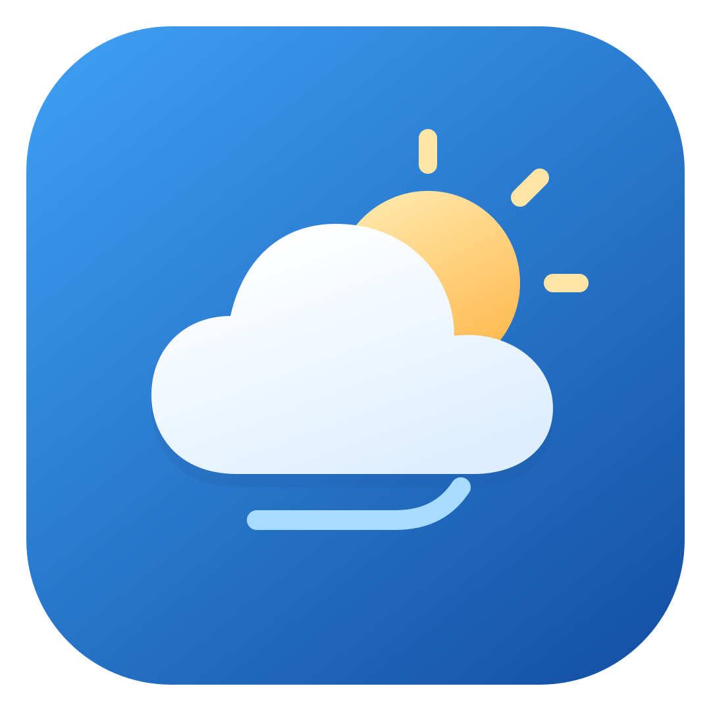

# Hydrogen OS 10 Style Weather App (Unofficial Recreation)

[中文](README.zh-CN.md)



An Android weather app inspired by the Hydrogen OS 10 weather app on the OnePlus 7 Pro. It uses native XML, Views and Canvas for the interface, 15 weather animations and tilt parallax. Weather data comes from [Open-Meteo](https://open-meteo.com/), with no API key required.

This project is for non-commercial learning and demonstration. It is not affiliated with, authorized by or endorsed by OnePlus, Hydrogen OS or the original weather app. The animations are drawn programmatically and contain no original app code, images, fonts or icons. This project grants no commercial-use permission; referenced names and trademarks belong to their owners.

## Features and controls

- **Weather home**: swipe between cities to view current conditions, a 6-day trend including today, hourly forecasts and 8 weather details. Supports pull-to-refresh and cached data offline.
- **15-day forecast**: open an in-app page showing up to 15 days starting tomorrow. Reuses fresh cached weather and refreshes expired data, with an offline fallback.
- **City management**: long-press a card or tap Edit to select cities with blue outlines and confirm batch deletion. Use the independent handle to drag or move cities through a menu. The located city stays first and cannot be removed. Each card has an animated background.
- **City search**: search with the full city name, or add one of 12 built-in popular cities.
- **Location**: permission is requested when the app has no cities; manual search remains available if denied. Uses the system `LocationManager` without a GMS dependency.
- **Animation debug**: open `⋮` → Animation debug to select a scene, day/night and simulated tilt. To return to weather control, choose Restore weather background and then Apply.
- **About**: an original logo, current version, author 薯格's GitHub and Douyin details, and offline documents with chapter navigation. Website links show a confirmation before opening a browser tab. Documents are currently displayed in Simplified Chinese.

Current version: **1.2**. No default city is preloaded. See [help](docs/USER_GUIDE.md) for controls and the [review record](docs/REVIEW.md) for remaining location and debug-gesture limitations (Chinese).

## Run

| Item | Current configuration |
| --- | --- |
| Android | Android 10 / API 29 or later |
| compileSdk / targetSdk | 37 |
| Build tools | AGP 9.3.3 / Gradle 9.5.0, with built-in Kotlin |
| Java | JDK 17+ to run Gradle; Android Studio's bundled JBR is recommended |
| Layout | Designed primarily for portrait phones; large-screen support is incomplete |
| Permissions | Internet; optional precise / approximate location |

Open the project root in an Android Studio version that supports the configured AGP, finish Gradle Sync and run `app`.

Command line on macOS / Linux:

```bash
# Set JAVA_HOME to your installation; this is a common macOS path.
export JAVA_HOME="/Applications/Android Studio.app/Contents/jbr/Contents/Home"
sh ./gradlew :app:assembleDebug

adb install -r app/build/outputs/apk/debug/app-debug.apk
adb shell am start -n com.sugar.weather/.MainActivity
```

On Windows, use `gradlew.bat :app:assembleDebug`. The repository's `gradlew` has no executable bit, so macOS / Linux examples invoke it through `sh`.

The APK is written to `app/build/outputs/apk/debug/app-debug.apk`. Local SDK paths in `local.properties` and machine-specific JDK bindings in `gradle/gradle-daemon-jvm.properties` are not committed.

Validation:

```bash
sh ./gradlew :app:lintDebug :app:testDebugUnitTest :app:assembleDebug
```

See the [review record](docs/REVIEW.md#验证记录) for v1.2 verification. New selection and repository tests cover located-city protection, late responses after deletion, concurrent changes and failure recovery. No emulator was launched for this revision. Gestures, TalkBack, icon masks and large-font layouts still need device acceptance checks.

## Data and limitations

| Data | Source and processing |
| --- | --- |
| Current, hourly, daily, sunrise and sunset | Open-Meteo Forecast API; requests 16 days including today |
| Model preference near China | Within the approximate box 18–54°N, 73–135°E, an additional CMA GRAPES request covers 5 days including today; remaining dates use `best_match` |
| Daily condition text | Aggregates hourly data in the city's local `[08:00, 20:00)` window. Home shows a representative condition; the 15-day page shows transitions |
| PM2.5 | Open-Meteo Air Quality API; the air-quality label is an approximate PM2.5 concentration band, not a complete Chinese AQI |
| City search | Open-Meteo Geocoding API; located-city naming uses the system Geocoder |

The CMA selection box includes parts of neighboring countries. Preferring that model does not guarantee a more accurate forecast. A failed `best_match` request fails the refresh; a CMA failure falls back to `best_match`; an air-quality failure retains the previous PM2.5 value, or displays “—” when none is available.

City pages check the 30-minute cache on first entry and whenever they resume, after disk-cache initialization. Pull-to-refresh is also available, and city management refreshes once when its ViewModel is created. There is no background polling. Pages use 16dp horizontal gutters and 48dp touch targets, with 14sp document text; the home temperature starts around 36% of the usable window height. See the [design notes](docs/DESIGN.md#6-页面与动画).

Weather data is attributed under **CC BY 4.0** on the About page. Open-Meteo's free service is intended for non-commercial use, has request limits and provides no availability guarantee. See the [official terms](https://open-meteo.com/en/terms).

Weather alerts, weather videos, widgets, sharing, feedback and settings are not implemented. Daily icons use daytime styling; hourly icons follow each day's sunrise and sunset. `HAZE`, `SANDSTORM`, `SLEET` and `STORM` are currently available only through debug selection. Units are fixed to °C, km/h, hPa and km.

## Scene recordings

All 15 scenes have day and night clips, for 30 recordings in total. Each is about 1–3.5 MB; a link may play or download the original MP4.

| Scene | Day recording | Night recording |
| --- | --- | --- |
| Sunny | [Day](https://github.com/SiXuManYan/hydrogen-weather-animation/raw/main/docs/scenes/sunny_day.mp4) | [Night](https://github.com/SiXuManYan/hydrogen-weather-animation/raw/main/docs/scenes/sunny_night.mp4) |
| Cloudy | [Day](https://github.com/SiXuManYan/hydrogen-weather-animation/raw/main/docs/scenes/cloudy_day.mp4) | [Night](https://github.com/SiXuManYan/hydrogen-weather-animation/raw/main/docs/scenes/cloudy_night.mp4) |
| Overcast | [Day](https://github.com/SiXuManYan/hydrogen-weather-animation/raw/main/docs/scenes/overcast_day.mp4) | [Night](https://github.com/SiXuManYan/hydrogen-weather-animation/raw/main/docs/scenes/overcast_night.mp4) |
| Fog | [Day](https://github.com/SiXuManYan/hydrogen-weather-animation/raw/main/docs/scenes/fog_day.mp4) | [Night](https://github.com/SiXuManYan/hydrogen-weather-animation/raw/main/docs/scenes/fog_night.mp4) |
| Haze | [Day](https://github.com/SiXuManYan/hydrogen-weather-animation/raw/main/docs/scenes/haze_day.mp4) | [Night](https://github.com/SiXuManYan/hydrogen-weather-animation/raw/main/docs/scenes/haze_night.mp4) |
| Sandstorm | [Day](https://github.com/SiXuManYan/hydrogen-weather-animation/raw/main/docs/scenes/sandstorm_day.mp4) | [Night](https://github.com/SiXuManYan/hydrogen-weather-animation/raw/main/docs/scenes/sandstorm_night.mp4) |
| Light rain | [Day](https://github.com/SiXuManYan/hydrogen-weather-animation/raw/main/docs/scenes/light_rain_day.mp4) | [Night](https://github.com/SiXuManYan/hydrogen-weather-animation/raw/main/docs/scenes/light_rain_night.mp4) |
| Moderate rain | [Day](https://github.com/SiXuManYan/hydrogen-weather-animation/raw/main/docs/scenes/rain_day.mp4) | [Night](https://github.com/SiXuManYan/hydrogen-weather-animation/raw/main/docs/scenes/rain_night.mp4) |
| Heavy rain | [Day](https://github.com/SiXuManYan/hydrogen-weather-animation/raw/main/docs/scenes/heavy_rain_day.mp4) | [Night](https://github.com/SiXuManYan/hydrogen-weather-animation/raw/main/docs/scenes/heavy_rain_night.mp4) |
| Rainstorm | [Day](https://github.com/SiXuManYan/hydrogen-weather-animation/raw/main/docs/scenes/storm_day.mp4) | [Night](https://github.com/SiXuManYan/hydrogen-weather-animation/raw/main/docs/scenes/storm_night.mp4) |
| Thunderstorm | [Day](https://github.com/SiXuManYan/hydrogen-weather-animation/raw/main/docs/scenes/thunder_day.mp4) | [Night](https://github.com/SiXuManYan/hydrogen-weather-animation/raw/main/docs/scenes/thunder_night.mp4) |
| Sleet | [Day](https://github.com/SiXuManYan/hydrogen-weather-animation/raw/main/docs/scenes/sleet_day.mp4) | [Night](https://github.com/SiXuManYan/hydrogen-weather-animation/raw/main/docs/scenes/sleet_night.mp4) |
| Light snow | [Day](https://github.com/SiXuManYan/hydrogen-weather-animation/raw/main/docs/scenes/light_snow_day.mp4) | [Night](https://github.com/SiXuManYan/hydrogen-weather-animation/raw/main/docs/scenes/light_snow_night.mp4) |
| Heavy snow | [Day](https://github.com/SiXuManYan/hydrogen-weather-animation/raw/main/docs/scenes/snow_day.mp4) | [Night](https://github.com/SiXuManYan/hydrogen-weather-animation/raw/main/docs/scenes/snow_night.mp4) |
| Hail | [Day](https://github.com/SiXuManYan/hydrogen-weather-animation/raw/main/docs/scenes/hail_day.mp4) | [Night](https://github.com/SiXuManYan/hydrogen-weather-animation/raw/main/docs/scenes/hail_night.mp4) |

## Debugging and screenshots

Intent extras can select a scene. Supplying `scene` enables debug preview until weather control is restored in the app.

| Extra | Type | Meaning |
| --- | --- | --- |
| `scene` | String | `SUNNY`, `CLOUDY`, `OVERCAST`, `FOG`, `HAZE`, `SANDSTORM`, `LIGHT_RAIN`, `RAIN`, `HEAVY_RAIN`, `STORM`, `THUNDER`, `SLEET`, `LIGHT_SNOW`, `SNOW`, `HAIL` |
| `night` | boolean | Night mode |
| `simulate` | boolean | Simulated tilt |
| `pitch` / `roll` | float | Simulated pitch / roll angles; use with `simulate=true` |
| `debug` | boolean | Display orientation values |

```bash
# Stop the previous instance so that new launch extras are read.
adb shell am force-stop com.sugar.weather
adb shell am start -n com.sugar.weather/.MainActivity \
  --es scene SUNNY --ez night false --ez simulate true \
  --ef pitch 90 --ef roll 0 --ez debug true
```

If physical tilt has no effect, disable simulated tilt in Animation debug and check the displayed values. Devices without an orientation sensor enable simulation automatically; touch-event delivery has a known issue described in the [review record](docs/REVIEW.md). Sunny-scene tuning is in `scene/SunnySceneConfig.kt`; other tuning points are in [design §10](docs/DESIGN.md#10-开发与调参入口).

In the sunny daytime scene, the flat-to-upright pitch range produces a smaller visual shift so halos and clouds remain visible while the phone lies flat. Debug values retain the actual device angles. The latest layout, document, Custom Tabs and flat-phone changes received static checks only; Gradle and device verification were not run for these changes.

## Documentation

| Document | Purpose |
| --- | --- |
| [Documentation index](docs/README.md) | Find user, legal and maintenance documents (Chinese) |
| [User guide](docs/USER_GUIDE.md) | Add, select, remove and reorder cities; troubleshooting (Chinese) |
| [User agreement](docs/legal/en/USER_AGREEMENT.md) | Service and usage conditions |
| [Brand assets](docs/brand/README.md) | Logo SVG, PNG, colors and generation (Chinese) |
| [Design and implementation](docs/DESIGN.md) | Data rules, architecture, caching, pages and animation constraints (Chinese) |
| [Review record](docs/REVIEW.md) | Cleanup, outstanding issues, optimization priorities and validation scope (Chinese) |
| [Changelog](CHANGELOG.md) | Version history (Chinese) |
| [Privacy policy](docs/legal/en/PRIVACY_POLICY.md) | Permissions, third-party requests, local storage and deletion |
| [Weather API selection](docs/free-weather-apis.md) | Alternatives and historical research (Chinese) |

For bugs or rights-holder feedback, please use [repository Issues](https://github.com/SiXuManYan/hydrogen-weather-animation/issues).
