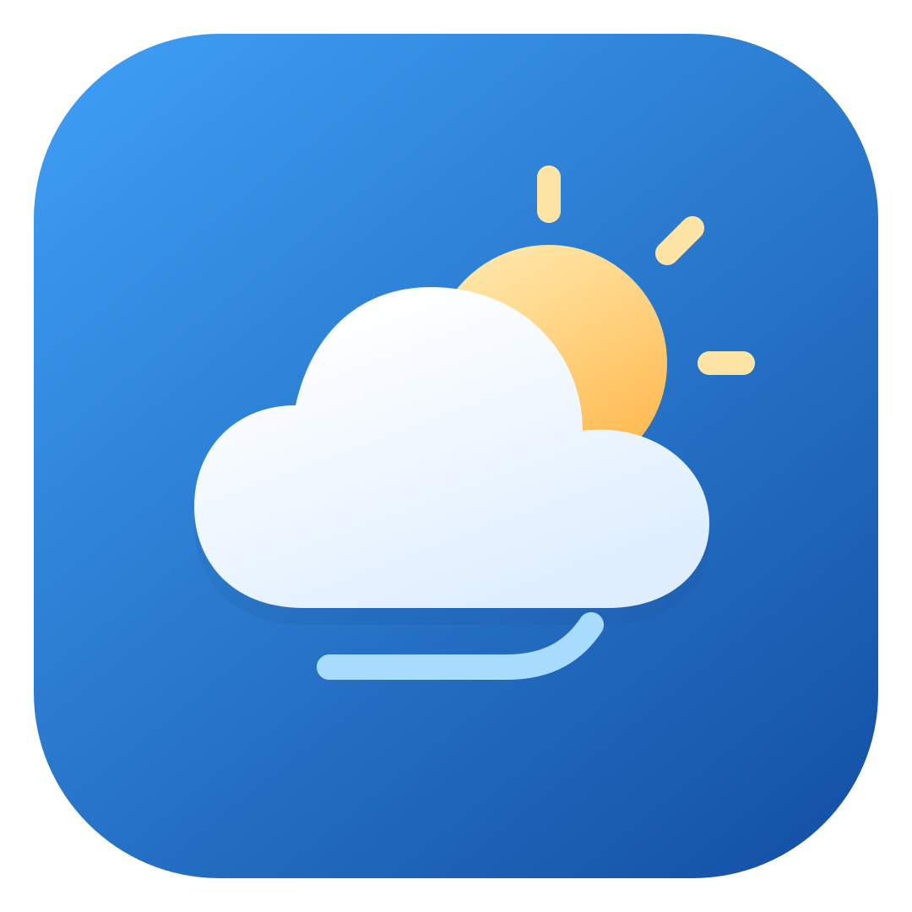

# 氢 OS 10 风格天气应用（非官方复刻）

[English](README.md)



以一加 7 Pro 的 Hydrogen OS 10 天气应用为视觉参考，用原生 XML + View + Canvas 实现天气界面、15 种天气动画和随手机倾斜变化的视差效果。天气数据来自 [Open-Meteo](https://open-meteo.com/)，无需 API Key。

本项目用于非商业学习与演示，与 OnePlus、Hydrogen OS 及原天气应用无隶属、授权或合作关系。动画以程序化方式绘制，不包含原应用的代码、图片、字体或图标。本项目不授予商业使用许可，相关名称与商标归各自权利人所有。

## 功能与操作

- **天气首页**：左右滑动切换城市，查看实况、含今天的 6 天趋势、逐小时预报和 8 项天气详情。每日摘要保留“阴转小雨”“小雨转小雪”等过程，文字完整换行；上滑阅读时动画背景轻微变暗，文字和按钮保持亮度。支持下拉刷新和离线缓存。
- **15 天预报**：点击首页按钮，按城市当地日期查看明天起最多 15 天预报。与首页共用每日摘要，补充凌晨、白天和夜间的变化。进入和恢复前台都会检查 30 分钟缓存并更新日期，过期刷新；失败时保留仍有效的离线预报。
- **桌面天气微件**：横向 5×1 布局，展示首城的实况、当天高低温和未来三天预报；约每 30 分钟用缓存重绘，离线也可推进日期，独立天气任务等待联网后请求。72dp 紧凑布局为预报图标保留 24dp，刷新按钮保留 48dp 触摸区。支持手动刷新与点击进入对应城市，可从应用“⋮ → 添加桌面微件”或桌面微件列表添加。
- **城市管理**：普通模式点击卡片直接回到首页对应城市，通过管理页搜索选城后也返回首页。长按卡片或点击编辑进入多选，蓝框标记所选城市，确认后批量删除。右侧手柄支持拖拽和上下移动菜单；定位城市固定置顶、不可删除。卡片动画共享 24fps 时钟，并按显示面积减少粒子。
- **城市搜索**：输入城市全名（如“大连市”）搜索，或从 12 个内置热门城市中直接添加。
- **定位**：精确和大致位置权限均可使用，首次没有城市时申请，拒绝后仍可手动添加。已授权后首页恢复前台时静默定位，成功后间隔 30 分钟、失败后间隔 2 分钟再尝试；移动至少 1km 时更新原定位城市及其天气。使用系统 `LocationManager`，不依赖 GMS，不在后台定位。
- **动画调试**：`⋮` →“动画调试”，可选择场景、昼夜和姿态模拟；点击“恢复天气背景”后再点“应用”，恢复由天气数据控制背景。
- **关于**：原创 Logo、当前版本、作者薯格的 GitHub 与抖音资料，以及支持章节跳转的离线文档；网页链接确认后通过浏览器标签页打开。
- **界面主题**：全局采用 Material 3 弹窗与控件，普通页面跟随系统浅色 / 深色；天气动画保持自身场景色。

当前版本 **1.3**（`versionCode = 4`）。首次启动不预置城市。本版变化见[更新日志](CHANGELOG.md)，完整操作见[使用帮助](docs/USER_GUIDE.md)，实现与验证范围见[审查记录](docs/REVIEW.md)。

## 运行

| 项目 | 当前配置 |
| --- | --- |
| Android 系统 | Android 10 / API 29 及以上 |
| compileSdk / targetSdk | 37 |
| 构建工具 | AGP 9.3.3 / Gradle 9.5.0，使用内置 Kotlin |
| Java | Gradle 运行需要 JDK 17+；推荐使用 Android Studio 自带 JBR |
| 布局 | 以竖屏手机为主要设计目标，大屏适配尚未完善 |
| 权限 | 网络；可选的精确 / 大致位置 |

用支持当前 AGP 的 Android Studio 打开项目根目录，完成 Gradle Sync 后运行 `app`。App 依赖仓库内的 [`core_framework` Library](core_framework/README.md)，该模块复制自 AndroidFrameworkTemplate 并适配宿主工具链，通过 HTTP 工厂为三个 Open-Meteo 服务共享客户端，不依赖本机的外部工程路径。

macOS / Linux 命令行：

```bash
# 按本机安装位置设置 JAVA_HOME；以下是 macOS 的常见路径。
export JAVA_HOME="/Applications/Android Studio.app/Contents/jbr/Contents/Home"
sh ./scripts/package.sh debug

adb install -r "app/release/HydrogenWeather_1.3_YYYY-MM-DD_debug.apk"
adb shell am start -n com.sugar.weather/.MainActivity
```

Windows 使用 `gradlew.bat :app:assembleDebug`。仓库中的 `gradlew` 没有可执行位，因此 macOS / Linux 示例通过 `sh` 调用。

APK 按 `HydrogenWeather_<versionName>_<yyyy-MM-dd>_<buildType>.apk` 命名并导出到 `app/release/`，安装示例中的 `YYYY-MM-DD` 需替换为实际构建日期。Debug 使用 Android 默认 `debug.jks`，无需项目签名凭据；Release 使用 `app/jks/weather.jks`，打包前需提供本机凭据，详见[打包说明](scripts/README.md)和[开发规则](AGENTS.md)。Release 构建启用 R8 代码优化与压缩。`local.properties` 的 SDK 路径和 `gradle/gradle-daemon-jvm.properties` 的本机 JDK 绑定不提交到仓库。根 `.gitignore` 同时排除本机签名目录 `app/jks/` 和 Android Studio 配置目录 `.idea/`；克隆后由 IDE 重新生成本机配置，打包 Release 时另行提供项目签名密钥。

验证命令：

```bash
sh ./gradlew :app:assembleDebug :app:assembleDebugAndroidTest \
  :app:testDebugUnitTest :core_framework:testDebugUnitTest \
  :app:lintDebug :core_framework:lintDebug
```

本轮审查修复前的检查已通过 Debug / AndroidTest APK 构建、78 个本地测试（App 65 个、Library 13 个）及两个模块的 Lint（均为 0 错误，分别 41 / 26 条警告），涵盖微件、全天气聚合、HTTP 和本机 JVM 列表用例。本轮优化按要求未重新运行构建、测试或 Lint，也未使用设备或模拟器；真实桌面显示、点击、长期后台调度和系统大字体仍待设备验收。历史执行范围见[项目审查记录](docs/REVIEW.md#验证记录)。

## 数据与限制

| 数据 | 来源与处理 |
| --- | --- |
| 实况、逐时、逐日、日出日落 | Open-Meteo Forecast API；请求今天起 16 天 |
| 中国附近坐标的模型偏好 | 在北纬 18°–54°、东经 73°–135°包围盒内，额外请求 CMA GRAPES 覆盖今天起 5 天；其余日期使用 `best_match` |
| 日天气描述 | 按城市本地自然日 `[00:00, 24:00)` 的逐小时数据聚合；两页共用短摘要，15 天页补充分时段描述 |
| PM2.5 | Open-Meteo Air Quality API；“空气质量”等级是 PM2.5 浓度阈值的近似分档，不是完整中国 AQI |
| 城市搜索 | Open-Meteo Geocoding API；定位城市命名由系统 Geocoder 完成 |

CMA 选择范围是粗略包围盒，可能包含邻国部分地区，采用该模型不保证比其他预报更准确，也不等同地方气象台的成品预报。日高低温保留所选模型的数值；摘要保留短时降水、雷暴、冰雹和冻雨，先后雨雪变化不推断为雨夹雪。`best_match` 请求失败时整次刷新失败；CMA 失败时回退到 `best_match`；空气质量失败时保留旧 PM2.5，无旧值时显示“—”。缺测指标保留“—”，不补成零；没有有效天气的空响应不覆盖旧报告，损坏缓存按条目跳过，不影响其他城市加载。同一城市的并发刷新共用正在执行的请求。

城市页和 15 天详情页进入、恢复前台时都会检查 30 分钟缓存，先等待磁盘预热，再决定是否请求；预报按城市当地日期筛选，跨日返回后不会继续显示已过去的日期。旧缓存用已有逐小时数据补齐每日摘要，不额外请求。正文回顶后，在标题下方的内容区下拉可强制刷新，刷新圈显示在标题下方；逐小时横滑优先保留在列表内。城市管理页创建时批量刷新一次。

添加桌面微件后，WorkManager 约每 30 分钟执行不要求联网的缓存重绘；离线时只要系统执行到任务，也会按城市当地日期更新当天高低温和未来槽位。独立联网任务等待网络可用后检查缓存或执行手动刷新，不在离线时反复请求。多个微件共享任务，移除最后一个后停止。两类任务仍可能受休眠、省电和厂商后台策略推迟，联网请求还取决于网络，不保证准点；后台只使用已保存坐标，不重新定位。前台定位使首城坐标改变时，微件也会重新请求天气。页面遵循 16dp 左右边距和 48dp 触摸目标，文档正文为 14sp；首页温度区约位于可用窗口高度的 36%，详见 [设计文档](docs/DESIGN.md#6-页面与动画)。

天气数据按 **CC BY 4.0** 署名，应用“关于”页已注明来源。Open-Meteo 免费接口面向非商业用途，有调用额度限制且无可用性保证，条款以 [官方说明](https://open-meteo.com/en/terms) 为准。

尚未实现气象预警、天气视频、分享、反馈和设置页。微件跟随城市列表第一项（定位城市优先），暂不支持每个微件单独选城；背景为随天气与昼夜切换的静态矢量图。逐日图标使用昼间样式，逐时图标按对应日期的日出日落切换；`HAZE`、`SANDSTORM`、`SLEET`、`STORM` 目前仅可通过调试选择。单位固定为 °C、km/h、hPa、km。

## 场景录屏

15 种场景各有日间和夜间录屏，共 30 段。单段约 1–3.5 MB；点击链接会播放或下载原始 MP4。

| 场景 | 日间录屏 | 夜间录屏 |
| --- | --- | --- |
| 晴天 | [日间](https://github.com/SiXuManYan/hydrogen-weather-animation/raw/main/docs/scenes/sunny_day.mp4) | [夜间](https://github.com/SiXuManYan/hydrogen-weather-animation/raw/main/docs/scenes/sunny_night.mp4) |
| 多云 | [日间](https://github.com/SiXuManYan/hydrogen-weather-animation/raw/main/docs/scenes/cloudy_day.mp4) | [夜间](https://github.com/SiXuManYan/hydrogen-weather-animation/raw/main/docs/scenes/cloudy_night.mp4) |
| 阴天 | [日间](https://github.com/SiXuManYan/hydrogen-weather-animation/raw/main/docs/scenes/overcast_day.mp4) | [夜间](https://github.com/SiXuManYan/hydrogen-weather-animation/raw/main/docs/scenes/overcast_night.mp4) |
| 雾 | [日间](https://github.com/SiXuManYan/hydrogen-weather-animation/raw/main/docs/scenes/fog_day.mp4) | [夜间](https://github.com/SiXuManYan/hydrogen-weather-animation/raw/main/docs/scenes/fog_night.mp4) |
| 霾 | [日间](https://github.com/SiXuManYan/hydrogen-weather-animation/raw/main/docs/scenes/haze_day.mp4) | [夜间](https://github.com/SiXuManYan/hydrogen-weather-animation/raw/main/docs/scenes/haze_night.mp4) |
| 沙尘暴 | [日间](https://github.com/SiXuManYan/hydrogen-weather-animation/raw/main/docs/scenes/sandstorm_day.mp4) | [夜间](https://github.com/SiXuManYan/hydrogen-weather-animation/raw/main/docs/scenes/sandstorm_night.mp4) |
| 小雨 | [日间](https://github.com/SiXuManYan/hydrogen-weather-animation/raw/main/docs/scenes/light_rain_day.mp4) | [夜间](https://github.com/SiXuManYan/hydrogen-weather-animation/raw/main/docs/scenes/light_rain_night.mp4) |
| 中雨 | [日间](https://github.com/SiXuManYan/hydrogen-weather-animation/raw/main/docs/scenes/rain_day.mp4) | [夜间](https://github.com/SiXuManYan/hydrogen-weather-animation/raw/main/docs/scenes/rain_night.mp4) |
| 大雨 | [日间](https://github.com/SiXuManYan/hydrogen-weather-animation/raw/main/docs/scenes/heavy_rain_day.mp4) | [夜间](https://github.com/SiXuManYan/hydrogen-weather-animation/raw/main/docs/scenes/heavy_rain_night.mp4) |
| 暴雨 | [日间](https://github.com/SiXuManYan/hydrogen-weather-animation/raw/main/docs/scenes/storm_day.mp4) | [夜间](https://github.com/SiXuManYan/hydrogen-weather-animation/raw/main/docs/scenes/storm_night.mp4) |
| 雷阵雨 | [日间](https://github.com/SiXuManYan/hydrogen-weather-animation/raw/main/docs/scenes/thunder_day.mp4) | [夜间](https://github.com/SiXuManYan/hydrogen-weather-animation/raw/main/docs/scenes/thunder_night.mp4) |
| 雨夹雪 | [日间](https://github.com/SiXuManYan/hydrogen-weather-animation/raw/main/docs/scenes/sleet_day.mp4) | [夜间](https://github.com/SiXuManYan/hydrogen-weather-animation/raw/main/docs/scenes/sleet_night.mp4) |
| 小雪 | [日间](https://github.com/SiXuManYan/hydrogen-weather-animation/raw/main/docs/scenes/light_snow_day.mp4) | [夜间](https://github.com/SiXuManYan/hydrogen-weather-animation/raw/main/docs/scenes/light_snow_night.mp4) |
| 大雪 | [日间](https://github.com/SiXuManYan/hydrogen-weather-animation/raw/main/docs/scenes/snow_day.mp4) | [夜间](https://github.com/SiXuManYan/hydrogen-weather-animation/raw/main/docs/scenes/snow_night.mp4) |
| 冰雹 | [日间](https://github.com/SiXuManYan/hydrogen-weather-animation/raw/main/docs/scenes/hail_day.mp4) | [夜间](https://github.com/SiXuManYan/hydrogen-weather-animation/raw/main/docs/scenes/hail_night.mp4) |

## 调试与截图

可通过 Intent extra 指定场景。`scene` 存在时进入调试预览，直到在应用内恢复天气背景。

| extra | 类型 | 含义 |
| --- | --- | --- |
| `scene` | String | `SUNNY`、`CLOUDY`、`OVERCAST`、`FOG`、`HAZE`、`SANDSTORM`、`LIGHT_RAIN`、`RAIN`、`HEAVY_RAIN`、`STORM`、`THUNDER`、`SLEET`、`LIGHT_SNOW`、`SNOW`、`HAIL` |
| `night` | boolean | 夜间模式 |
| `simulate` | boolean | 触摸模拟倾斜 |
| `pitch` / `roll` | float | 模拟俯仰 / 横滚角，配合 `simulate=true` |
| `debug` | boolean | 显示姿态数值 |

```bash
# 多次截图之间先结束旧实例，确保启动参数被重新读取。
adb shell am force-stop com.sugar.weather
adb shell am start -n com.sugar.weather/.MainActivity \
  --es scene SUNNY --ez night false --ez simulate true \
  --ef pitch 90 --ef roll 0 --ez debug true
```

倾斜没有反应时，在“动画调试”中关闭触摸模拟，并观察调试数值。没有姿态传感器的设备会自动开启模拟；开启模拟后，在天气内容上拖动即可调整倾斜，同时保留正文滚动和城市、小时列表的横向操作。晴天光晕、云朵和视差参数集中在 `scene/SunnySceneConfig.kt`；其余调参入口见 [设计文档 §10](docs/DESIGN.md#10-开发与调参入口)。

晴天白天把平放至竖直的设备角度映射为更小幅的视觉变化，使平放时也能看到光晕和云朵；调试读数仍显示真实角度。

## 项目文档

| 文档 | 用途 |
| --- | --- |
| [文档索引](docs/README.md) | 按任务查找用户、法律、设计与维护文档 |
| [使用帮助](docs/USER_GUIDE.md) | 添加、批量删除、排序城市，刷新与常见问题 |
| [用户协议](docs/legal/USER_AGREEMENT.md) | 服务与使用边界；附[英文](docs/legal/en/USER_AGREEMENT.md) |
| [品牌资产](docs/brand/README.md) | Logo 的 SVG、PNG、色彩与生成方式 |
| [设计与实现](docs/DESIGN.md) | 数据规则、架构、缓存、页面与动画约束 |
| [审查记录](docs/REVIEW.md) | 本次清理、待修复问题、优化顺序与验证范围 |
| [更新日志](CHANGELOG.md) | 版本变更 |
| [隐私政策](docs/legal/PRIVACY_POLICY.md) | 权限、第三方请求、本地存储与删除；附[英文](docs/legal/en/PRIVACY_POLICY.md) |
| [天气 API 选型](docs/free-weather-apis.md) | 备选服务和历史调研 |

问题与权利人反馈请通过 [仓库 Issues](https://github.com/SiXuManYan/hydrogen-weather-animation/issues) 联系。
