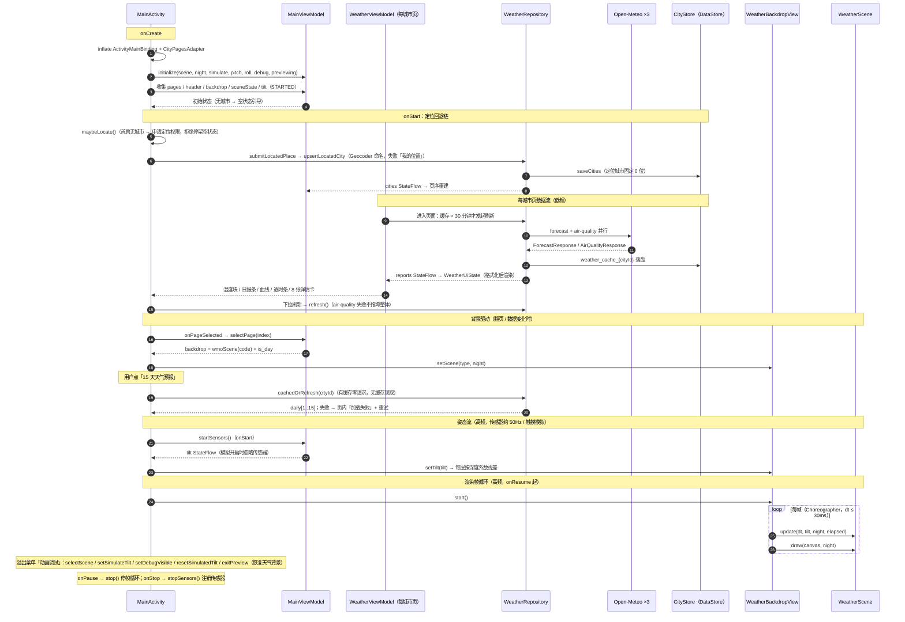

# 氢 OS10 风格天气应用复刻（非官方）

[](README.md)

> 这段动画来自我使用过的 OnePlus 7 Pro（GM1901），系统为 Android 10 / Hydrogen OS 10.0.10.GM21。这个版本内置的天气应用动画非常出色，色彩层次、光影和随手机倾斜的视差都做得很极致。为了还原这个效果，我用 Android 原生 View + Canvas 做了一次非官方的复刻与模拟，向这个出色的系统应用致敬。

本项目在传统 XML + 自定义 View 的 Android 工程里，复刻氢 OS10 风格天气应用的完整首页体验：天气数据来自 Open-Meteo 免费接口（中国境内前 5 天优先使用 CMA GRAPES 模型），支持多城市管理、城市搜索、15 天天气预报与两列详情卡；15 种天气场景动画全部由纯 `Canvas` 程序化绘制，随实况天气码自动切换，并保留随手机倾斜的视差。

场景动画部分**不依赖第三方动画库、不包含原应用的代码、图片、字体、图标或其他素材**；数据部分联网请求 Open-Meteo（免费、无需 key），定位使用系统 LocationManager。详细的数据源选型、WMO 天气码映射表与页面规格见 [docs/DESIGN.md](docs/DESIGN.md)。

> **免责声明**：本项目为非官方、非商业的学习与效果演示，仅对天气应用的视觉表现做复刻 / 模拟，与 OnePlus、Hydrogen OS 及相关天气应用无任何关联，也未获得其授权或背书；相关名称、商标及原应用素材归其权利人所有。请勿将本项目用于商业用途。

## 场景录屏

单个场景约 1~3.5MB。点击链接会打开 raw 视频文件，浏览器可能直接播放或触发下载；GitHub 不支持在 README 中内嵌 MP4。

| 场景 | 日间录屏 | 夜间录屏 |
| --- | --- | --- |
| 晴天 | [日间](https://github.com/SiXuManYan/hydrogen-weather-animation/raw/main/docs/scenes/sunny_day.mp4) | [夜间](https://github.com/SiXuManYan/hydrogen-weather-animation/raw/main/docs/scenes/sunny_night.mp4) |
| 多云 | [日间](https://github.com/SiXuManYan/hydrogen-weather-animation/raw/main/docs/scenes/cloudy_day.mp4) | [夜间](https://github.com/SiXuManYan/hydrogen-weather-animation/raw/main/docs/scenes/cloudy_night.mp4) |
| 阴天 | [日间](https://github.com/SiXuManYan/hydrogen-weather-animation/raw/main/docs/scenes/overcast_day.mp4) | [夜间](https://github.com/SiXuManYan/hydrogen-weather-animation/raw/main/docs/scenes/overcast_night.mp4) |
| 雾 | [日间](https://github.com/SiXuManYan/hydrogen-weather-animation/raw/main/docs/scenes/fog_day.mp4) | [夜间](https://github.com/SiXuManYan/hydrogen-weather-animation/raw/main/docs/scenes/fog_night.mp4) |
| 霾 | [日间](https://github.com/SiXuManYan/hydrogen-weather-animation/raw/main/docs/scenes/haze_day.mp4) | [夜间](https://github.com/SiXuManYan/hydrogen-weather-animation/raw/main/docs/scenes/haze_night.mp4) |
| 沙尘暴 | [日间](https://github.com/SiXuManYan/hydrogen-weather-animation/raw/main/docs/scenes/sandstorm_day.mp4) | [夜间](https://github.com/SiXuManYan/hydrogen-weather-animation/raw/main/docs/scenes/sandstorm_night.mp4) |
| 小雨 | [日间](https://github.com/SiXuManYan/hydrogen-weather-animation/raw/main/docs/scenes/light_rain_day.mp4) | [夜间](https://github.com/SiXuManYan/hydrogen-weather-animation/raw/main/docs/scenes/light_rain_night.mp4) |
| 中雨 | [日间](https://github.com/SiXuManYan/hydrogen-weather-animation/raw/main/docs/scenes/rain_day.mp4) | [夜间](https://github.com/SiXuManYan/hydrogen-weather-animation/raw/main/docs/scenes/rain_night.mp4) |
| 大雨 | [日间](https://github.com/SiXuManYan/hydrogen-weather-animation/raw/main/docs/scenes/heavy_rain_day.mp4) | [夜间](https://github.com/SiXuManYan/hydrogen-weather-animation/raw/main/docs/scenes/heavy_rain_night.mp4) |
| 暴雨 | [日间](https://github.com/SiXuManYan/hydrogen-weather-animation/raw/main/docs/scenes/storm_day.mp4) | [夜间](https://github.com/SiXuManYan/hydrogen-weather-animation/raw/main/docs/scenes/storm_night.mp4) |
| 雷阵雨 | [日间](https://github.com/SiXuManYan/hydrogen-weather-animation/raw/main/docs/scenes/thunder_day.mp4) | [夜间](https://github.com/SiXuManYan/hydrogen-weather-animation/raw/main/docs/scenes/thunder_night.mp4) |
| 雨夹雪 | [日间](https://github.com/SiXuManYan/hydrogen-weather-animation/raw/main/docs/scenes/sleet_day.mp4) | [夜间](https://github.com/SiXuManYan/hydrogen-weather-animation/raw/main/docs/scenes/sleet_night.mp4) |
| 小雪 | [日间](https://github.com/SiXuManYan/hydrogen-weather-animation/raw/main/docs/scenes/light_snow_day.mp4) | [夜间](https://github.com/SiXuManYan/hydrogen-weather-animation/raw/main/docs/scenes/light_snow_night.mp4) |
| 大雪 | [日间](https://github.com/SiXuManYan/hydrogen-weather-animation/raw/main/docs/scenes/snow_day.mp4) | [夜间](https://github.com/SiXuManYan/hydrogen-weather-animation/raw/main/docs/scenes/snow_night.mp4) |
| 冰雹 | [日间](https://github.com/SiXuManYan/hydrogen-weather-animation/raw/main/docs/scenes/hail_day.mp4) | [夜间](https://github.com/SiXuManYan/hydrogen-weather-animation/raw/main/docs/scenes/hail_night.mp4) |

> 目前共 30 段场景录屏，覆盖全部 15 个场景。

---

## 1. 功能特性

### 主天气页（多城市）

- 全屏单实例 `WeatherBackdropView` 场景动画，其上透明 `ViewPager2` 承载「每城市一页」，左右滑动切换城市；背景只渲染当前选中城市的天气场景。
- 头部 overlay：定位图钉（仅定位城市显示）+ 城市名 + 「刚刚更新 / X 分钟前更新」（30s 心跳重算）；右侧城市管理图标与溢出菜单（关于 / 动画调试）。
- 单页内容（自上而下）：
  1. 约半屏高度的纯背景动画留白；
  2. 当前温度块：大号温度 + 天气描述 + 高/低温（`16/3°C`）；
  3. 6 天日报条（今天 + 未来 5 天）：星期（今天列固定「今天」）/ 日期 + 天气图标 + 天气文字；
  4. 高/低双温度曲线：自绘 `WeatherTrendView`，与日报条 6 列逐像素对齐，两线间带垂直渐变填充带；
  5. **『15 天天气预报』按钮**（见 §2：应用内详情页，不跳浏览器）；
  6. 逐小时条：从实况下一整点起 24 小时（时间 / 图标 / 温度），并按今天的日出、日落时刻插入太阳节点；
  7. 两列详情卡 × 8：空气质量等级、PM2.5、风向风速、体感温度、湿度、能见度、紫外线、气压，行间带分割线。
- 下拉刷新；缓存超过 30 分钟进入页面自动刷新。
- 首启无城市时显示空状态（图钉 + 「添加城市，查看天气」+ 「添加城市」按钮），**不预置假城市**。

### 城市管理页

- 每城市一张全宽圆角动画卡片：卡片背景由 `WeatherCardBackdropView` 以该城市的天气场景渲染小动画（24fps 节流，粒子密度按 0.35 缩放），文字为城市名 + `{温度}°{天气}`。
- 长按拖拽排序；左滑删除（定位城市固定首位，不可拖拽、不可删除）；点击卡片返回主页并切到该城市。
- 右下角白色圆形 FAB「+」进入搜索添加页；打开页面时后台并行刷新全部城市天气（并发限 4）。

### 搜索添加城市

- 顶部搜索框自动聚焦，输入 300ms 防抖后调用 Open-Meteo geocoding 搜索；结果按 population 优先排序（避免「大连」只命中同名村镇的短名陷阱），行内显示 `城市 · 省份 · 国家`。
- 内置 12 个热门城市 tag（北京/上海/广州/深圳/成都/杭州/武汉/西安/沈阳/大连/哈尔滨/乌鲁木齐，不走网络）；点击结果或热门 tag 即添加城市并返回主页切到新城市。
- 同 id 或同坐标（约 ±11m）的城市自动去重。

### 关于页

- 静态页：云朵 logo + 「氢天气 V1.1」+ 更新日志 + **「数据来源：Open-Meteo（CC-BY 4.0）；中国境内前 5 天 CMA GRAPES；日天气按白天 08:00–20:00 逐小时聚合」署名**（合规必须）+ 用户协议占位 + 隐私政策入口（应用内摘要，完整政策见 [docs/PRIVACY.md](docs/PRIVACY.md)）。

### 定位

- 首启无城市时请求定位权限（fine + coarse）；拒绝则停留在空状态，可手动搜索添加。
- 框架 `LocationManager` 一次性定位（不依赖 GMS）：5 分钟内的 lastKnown 直接使用，否则监听首个精度 ≤100m 的修复，10 秒超时视为失败。
- 命名用框架 Geocoder（locality → subAdminArea → adminArea），失败回退「我的位置」；定位城市固定列表首位。

### 天气场景动画与视差

- 15 种 Canvas 场景按实况 WMO weather_code 自动切换，昼夜由实况 `is_day` 决定（无数据时按时钟粗估）；倾斜视差、触摸模拟倾斜、俯仰/横滚调试信息全部保留，入口移至溢出菜单「动画调试」。

---

## 2. 数据来源

天气与城市搜索数据全部来自 [Open-Meteo](https://open-meteo.com/) 的三个免费接口，无需 API key：

| 接口 | 用途 |
| --- | --- |
| `https://api.open-meteo.com/v1/forecast` | 实况 + 逐小时 + 逐日（`forecast_days=16`，即今天 + 未来 15 天）+ 日出日落 |
| `https://air-quality-api.open-meteo.com/v1/air-quality` | PM2.5 实况（空气质量等级卡） |
| `https://geocoding-api.open-meteo.com/v1/search` | 城市搜索（搜索添加页） |

- **模型选择（2026-11）**：中国境内坐标（粗略包围盒：北纬 18°–54°、东经 73°–135°）前 5 天请求 **CMA GRAPES** 全球模型（`models=cma_grapes_global`、`forecast_days=5`）；第 6–15 天与非中国坐标使用 Open-Meteo `best_match`。两个 forecast 请求并行执行，CMA 失败时静默回退，不影响整体刷新。实况、时区与 `observedAt` 优先 CMA；逐日按日期合并（CMA 覆盖的日期优先），逐时按时间合并。
- **日天气取样（2026-11）**：Open-Meteo 的 `daily.weather_code` 表示“当天最严重的小时天气”，一场两小时大雪会把全天标成「大雪」。现在改为按城市本地 **08:00–20:00** 的逐小时天气聚合：出现次数最多的天气码作为图标与首页短文案（同票按降水 > 云 > 晴、雪 > 雨的保守顺序取舍）；存在显著连续分段时生成转折文案，如「毛毛雨转晴」「小雨转中雪」，在 15 天页展示。夜间降水不参与白天描述。
- **署名要求**：Open-Meteo 采用 **CC-BY 4.0** 许可，使用其数据必须注明来源——本项目已在「关于页」展示「数据来源：Open-Meteo（CC-BY 4.0）」及 CMA / 取样方式说明。额度方面 Open-Meteo 为公益免费服务（API 文档公布的非商用限流内即可满足本项目这类低频请求），本项目仅在进入页面 / 下拉刷新 / 打开城市管理时按需请求，无后台轮询。
- **连通性**：设计会话对三接口的完整 curl 实测（含字段样本）记录在 [docs/DESIGN.md](docs/DESIGN.md) §1.1 / §12.1；本次文档更新时对三接口复测，均返回 HTTP 200。
- **失败语义**：forecast 请求失败按整体失败处理（有缓存显示旧数据 + 「X 分钟前更新」，无缓存显示错误 + 重试）；air-quality 失败不拖垮整体，PM2.5 沿用旧值（缺失显示「—」）。所有网络异常在数据层统一包装为 `WeatherDataException`。
- **heytap 网页的用途**：原版一加天气的『15 天天气预报』按钮会外跳其服务端签发的 mobileLink 网页（OPPO/heytap 体系）。本项目**不使用** heytap 接口与网页（决策依据见 [docs/DESIGN.md](docs/DESIGN.md) D2/§1.2，接口存档见其附录 A）：按钮改为打开**应用内 15 天详情页**（`FifteenDayActivity`），数据取同一份 forecast 响应的 `daily[1..15]`（明天起 15 天），零额外网络请求；无缓存时现场重新拉取，网络也失败则页内显示「加载失败，请检查网络」+ 重试按钮——不存在「跳浏览器失败」的场景。
- **相关文档**：[CHANGELOG.md](CHANGELOG.md) · [docs/PRIVACY.md](docs/PRIVACY.md) · [docs/free-weather-apis.md](docs/free-weather-apis.md) · [docs/DESIGN.md](docs/DESIGN.md)

---

## 3. 运行环境

| 项目 | 要求 |
| --- | --- |
| Android Studio | 2026.1+（当前工程使用 AGP 9.3.3 / Gradle 9.5） |
| JDK | 17+（命令行构建需要；可把 `JAVA_HOME` 指到 Android Studio 自带的 JBR） |
| compileSdk / targetSdk | 37 |
| minSdk | 29 |
| 屏幕方向 | 竖屏锁定 |
| 权限 | `INTERNET`、`ACCESS_NETWORK_STATE`、`ACCESS_FINE_LOCATION`、`ACCESS_COARSE_LOCATION` |

---

## 4. 运行方式

### Android Studio

1. `File → Open` 选择你克隆后的项目根目录（包含 `settings.gradle.kts` 的目录）。
2. 等待 Gradle Sync 完成（首次需要联网下载依赖）。
3. 选择 `app` 运行配置，点击 Run。

### 命令行

```bash
# 需要 JDK 17+；没有独立 JDK 时可直接用 Android Studio 自带的 JBR：
#   export JAVA_HOME="/Applications/Android Studio.app/Contents/jbr/Contents/Home"
# 本仓库的 gradlew 未保留可执行位，用 sh 调用：
sh ./gradlew assembleDebug

adb install -r app/build/outputs/apk/debug/app-debug.apk
adb shell am start -n com.sugar.weather/.MainActivity
```

生成的 APK 位于：

```
app/build/outputs/apk/debug/app-debug.apk
```

> 说明：本次实现按用户要求跳过了命令行编译验证（未执行 `gradlew` 构建）；以上为标准构建流程，首次构建请以 Android Studio Gradle Sync 结果为准。版本依据与风险清单见 [docs/DESIGN.md](docs/DESIGN.md) §10.1/§11。

---

## 5. 操作说明

- **左右滑动**：切换多城市页面，背景动画跟随当前城市的天气。
- **头部**：左侧为定位图钉 + 城市名 + 更新时间；右侧城市管理图标进入「选择城市」页，`⋮` 溢出菜单进入「关于」或「动画调试」。
- **动画调试**（原右下角「场景」按钮移入溢出菜单）：切换天气场景、日间/夜间、触摸模拟、调试信息、重置视角；背景会跟随调试选择，点「恢复天气背景」后交还给实况天气驱动。
- **触摸模拟倾斜**：
  - 关闭时使用真实方向传感器；
  - 打开后可用手指拖动模拟倾斜（无方向传感器的设备会自动打开）；
  - 左右拖动改变横滚，上下拖动改变俯仰。
- **下拉刷新**当前城市天气；点「15 天天气预报」进入应用内详情页。
- **倾斜手机**：左右横滚（roll）驱动场景横向视差；前后俯仰（pitch）驱动纵向移动与轻微缩放。

> 如果倾斜手机没有反应，先检查「动画调试」里触摸模拟是否被打开；打开时会覆盖真实传感器数据。

---

## 6. 支持的场景

| SceneType | 中文 | 实现方式 |
| --- | --- | --- |
| `SUNNY` | 晴天 | 8 层多边形光晕 + 4 个六边形云；夜间切换为流星弧线 |
| `CLOUDY` | 多云 | 9 个半透明圆形云团 + 太阳；夜间增加星点 |
| `OVERCAST` | 阴天 | 同多云，使用灰蓝色云团色板 |
| `FOG` | 雾 | 24 个线性渐变圆，缓慢漂移、旋转、叠加 |
| `HAZE` | 霾 | 大量半透明黄褐色颗粒漂移、闪烁 |
| `SANDSTORM` | 沙尘暴 | 暖色渐变 + 沙尘团 + 高速横向沙粒 |
| `LIGHT_RAIN` | 小雨 | 雨滴线段粒子 |
| `RAIN` | 中雨 | 密度、速度、线宽更高的雨滴粒子 |
| `HEAVY_RAIN` | 大雨 | 更密集的雨滴粒子 |
| `STORM` | 暴雨 | 最高密度的雨滴粒子 |
| `THUNDER` | 雷阵雨 | 雨滴粒子 + 随机闪电闪光 |
| `SLEET` | 雨夹雪 | 小雨 + 小雪叠加 |
| `LIGHT_SNOW` | 小雪 | 少量雪花（圆点 / 六边形） |
| `SNOW` | 大雪 | 密集雪花 |
| `HAIL` | 冰雹 | 雨滴 + 白色冰雹颗粒 |

昼夜与场景切换规则（v1 起自动化）：

- 实况 WMO weather_code → `SceneType` 的完整映射表见 [docs/DESIGN.md](docs/DESIGN.md) §4；未知码一律回退「多云」。
- WMO 码表不含霾与沙尘，因此 `HAZE`、`SANDSTORM` 不做自动映射，仅可通过「动画调试」手动进入；`SLEET` 同理仅调试入口可达。
- 夜间由实况 `is_day` 字段决定（仅实况；逐时/逐日条目一律昼间样式）；无数据时按时钟粗估（19:00 起或 06:00 前为夜）。

---

## 7. 直接启动指定场景（方便截图 / 验收）

`MainActivity` 支持以下 Intent extra（带 `scene` extra 时进入调试预览，背景跟随该场景，直到在「动画调试」里点「恢复天气背景」）：

| key | 类型 | 说明 |
| --- | --- | --- |
| `scene` | String | `SceneType` 名称，如 `SUNNY`、`RAIN`、`SNOW` |
| `night` | boolean | 是否夜间 |
| `simulate` | boolean | 是否启用触摸模拟 |
| `pitch` | float | 模拟俯仰角（配合 `simulate=true`） |
| `roll` | float | 模拟横滚角（配合 `simulate=true`） |
| `debug` | boolean | 是否显示调试信息 |

示例：

```bash
# 晴天日间，模拟竖直握持
adb shell am start -n com.sugar.weather/.MainActivity \
  --es scene SUNNY --ez night false --ez simulate true --ef pitch 90 --ef roll 0

# 雷阵雨夜间
adb shell am start -n com.sugar.weather/.MainActivity \
  --es scene THUNDER --ez night true

# 打开调试数值
adb shell am start -n com.sugar.weather/.MainActivity \
  --es scene SUNNY --ez debug true
```

> 同一个 Activity 已在运行时，使用 `am start` 可能只把旧实例带到前台。需要在多次截图之间切换场景时，先执行 `adb shell am force-stop com.sugar.weather`，或用系统「返回」退出后再启动。

---

## 8. 代码结构

```
app/src/main/java/com/sugar/weather/
├── MainActivity.kt                 # 主页：ViewPager2 + 头部 overlay + 定位流程 + 调试对话框
├── WeatherApplication.kt           # Application，持有 AppContainer
├── di/
│   └── AppContainer.kt             # 手写 DI：3 个 Open-Meteo 实例 / 仓库 / 存储 / 定位
├── data/
│   ├── model/                      # City、WeatherReport 等领域模型
│   ├── remote/                     # OpenMeteoApi（Retrofit）+ DTO + OkHttpClient
│   ├── CityStore.kt                # DataStore Preferences：城市列表 + 天气缓存（JSON）
│   ├── WeatherRepository.kt        # 唯一数据出入口：reports/cities StateFlow + 刷新/增删城市
│   ├── LocationDataSource.kt       # 框架 LocationManager 一次性定位
│   ├── WeatherCodes.kt             # WMO 码 → 描述/场景 + 空气质量/紫外线/风向映射（纯函数）
│   ├── WeatherFormat.kt            # 数值与单位格式化（纯函数）
│   ├── WeatherMapper.kt            # DTO → 领域模型 + 逐小时窗口裁剪
│   ├── WeatherDataException.kt     # 数据层统一错误类型
│   └── TiltSensorRepository.kt     # 方向传感器 → StateFlow
├── sensor/
│   └── TiltSensorController.kt     # TYPE_ORIENTATION / TYPE_ROTATION_VECTOR 封装
├── ui/
│   ├── MainViewModel.kt            # 页序/头部/背景驱动 + 场景调试状态 + 姿态
│   ├── SceneUiState.kt             # 调试面板状态
│   ├── CityPagesAdapter.kt         # ViewPager2 适配器（每城市一个 WeatherFragment）
│   ├── weather/                    # 单城市页：Fragment + ViewModel + 日报/逐时适配器 + 图标映射
│   ├── city/                       # 城市管理页
│   ├── search/                     # 搜索添加页（含内置热门城市表）
│   ├── fifteenday/                 # 15 天详情页
│   └── about/                      # 关于页
├── view/
│   ├── WeatherBackdropView.kt      # 全屏纯 Canvas 渲染 + Choreographer + 触摸姿态回调
│   ├── WeatherTrendView.kt         # 高/低双温度曲线（自绘）
│   ├── WeatherSingleInfoView.kt    # 两列详情卡单元
│   └── WeatherCardBackdropView.kt  # 城市卡小动画背景（24fps 节流）
└── scene/                          # 15 种天气场景（纯 Canvas，未随本次改动）
    ├── WeatherScene.kt / SceneType.kt / Tilt.kt
    ├── SunnyScene.kt / SunnySceneConfig.kt
    ├── CloudScene.kt / FogScene.kt / HazeScene.kt / SandstormScene.kt
    └── RainScene.kt / SnowScene.kt / CompositeScene.kt

app/src/main/res/
├── layout/                         # activity_main / fragment_weather / 各页面与列表项布局
├── menu/menu_main_overflow.xml     # 溢出菜单：关于 / 动画调试
├── drawable/ic_*.xml               # 手写矢量图标
└── values/                         # colors / dimens / strings / themes
```

---

## 9. 架构与数据流

### 9.1 MVVM 分层

- **View 层**（Activity / Fragment / 自定义 View）：只做 ViewBinding、insets、跳转，把用户输入提交给 ViewModel；不持有业务对象，不 import 数据层内部类型。
- **ViewModel 层**：每城市页一个 `WeatherViewModel`，另有 `MainViewModel`（页序/头部/背景驱动/调试）、`CityManageViewModel`、`CitySearchViewModel`、`FifteenDayViewModel`；全部持有 `StateFlow<UiState>`，文本格式化在 ViewModel 完成。
- **仓库层**：`WeatherRepository` 是唯一数据出入口（网络访问收敛于此，换数据源只改 `data/remote/dto/` + Mapper）；内存 `reports` StateFlow + DataStore 缓存（启动时磁盘预热进内存）。
- **数据层**：Retrofit + Gson（免编译器插件）、DataStore Preferences、框架 LocationManager；`WeatherCodes` / `WeatherFormat` / `WeatherMapper` 为纯 Kotlin 函数。
- **动画层**：`scene/` 15 场景 + `WeatherBackdropView`（60fps 帧循环不经过 ViewModel）+ `WeatherCardBackdropView`（卡片 24fps）。

数据源决策、WMO 映射表、页面视觉规格与文件级清单的完整记录在 [docs/DESIGN.md](docs/DESIGN.md)，本节只作索引不重复全文。

### 9.2 运行时序图

下图按当前实现绘制：低频的天气数据流（含定位、缓存、背景驱动）与两条高频流（传感器姿态、渲染帧循环）。实线为直接调用，虚线为 StateFlow 发射或回调。



Activity 只负责 ViewBinding 绑定和事件转发；`WeatherBackdropView` 不直接访问 `SensorManager`，也不接触 Repository；传感器生命周期和 UI 状态都由 `MainViewModel` / `TiltSensorRepository` 管理。

---

## 10. 调参入口

| 想改什么 | 修改位置 |
| --- | --- |
| 晴天光晕半径、旋转速度、颜色、深度、夜间弧线 | `SunnySceneConfig.kt` |
| 晴天云朵大小 / 位置 / 透明度 | `SunnySceneConfig.kt` 的 `CLOUD_*` |
| 晴天视差范围、平滑速度 | `SunnySceneConfig.kt` 的 `HORIZONTAL_RANGE_DP`、`FOLLOW_*` |
| 各天气的背景色 | `SceneType.kt` |
| 多云 / 阴天云团参数 | `CloudScene.kt` 的 `init` 表 |
| 雨量、速度、线宽、冰雹 | `RainScene.kt` 的 `Intensity` 配置块 |
| 雪量、雪花大小、数量 | `SnowScene.kt` 的 `count` 与 `init` |
| 霾 / 沙尘颗粒密度 | `HazeScene.kt`、`SandstormScene.kt` 的 `COUNT` |
| 城市卡动画帧率 / 粒子密度 | `WeatherCardBackdropView.kt`（24fps / 0.35） |
| 温度曲线样式（渐变、线宽、标签） | `WeatherTrendView.kt` |

---

## 11. 常见问题

### 11.1 手机倾斜没有反应

- 打开 `⋮` → 「动画调试」，确认「触摸模拟倾斜」已关闭；
- 打开调试信息，观察 `pitch` / `roll` 是否变化；
- 部分设备没有 `TYPE_ORIENTATION` 时，会回退到旋转矢量传感器；
- 模拟器没有真实姿态变化，请使用触摸模拟。

### 11.2 切换场景后还是旧场景

通过 adb 多次 `am start` 启动同一 Activity 时，系统可能复用旧实例。先 `adb shell am force-stop com.sugar.weather` 再启动，或在 App 内 `⋮` → 「动画调试」切换。

### 11.3 画面构图和参考图略有差异

光晕半径按屏幕密度缩放；不同分辨率 / 显示缩放下，色带覆盖屏幕的比例会略有不同。已在 `SunnyScene.kt` 中按「最外圈下沿约在 1/3 屏高」做了归一化，可通过 `initialVertical` 一行微调。

### 11.4 页面显示「加载失败」或「X 分钟前更新」

- 「加载失败，请检查网络」+ 重试：当前城市无任何缓存且请求失败，检查网络后点重试或下拉刷新；
- 「X 分钟前更新」+ 旧数据：请求失败但存在磁盘缓存，App 离线可用（渲染缓存数据）；
- 搜索城市无结果时，尝试输入城市全名（如「大连市」而非「大连」，见 §2 短名陷阱）。

---

## 12. 已知范围

- 未实现：气象预警（无免费中国预警数据源，头部告警图标为占位隐藏）、天气视频、桌面小部件 / 分享 / 反馈 / 设置页、后台定时刷新（仅前台：进入页面缓存超 30 分钟、下拉刷新、城市管理页批量刷新）。
- 空气质量只展示 PM2.5 浓度与等级文字，接口返回的 US AQI 字段保留在 DTO 中未上 UI。
- `HAZE` / `SANDSTORM` / `SLEET` 不参与实况自动映射（WMO 码表无对应），仅「动画调试」可达。
- 单位固定公制（°C、km/h、hPa、km）；用户协议 / 隐私政策为关于页占位文案，无实际链接。
- 晴天场景按参考截图做了较完整的视觉模拟；其余场景为基于同类天气效果的程序化近似实现。

---

## 13. 版权与免责声明

- 本项目是独立实现的学习 / 演示项目，仅以程序化绘制方式复刻、模拟天气应用的视觉表现。
- 场景动画不包含任何原应用的代码、图片、字体、图标或其他素材，也未获得相关权利人的授权、合作或背书。
- 天气数据来自 [Open-Meteo](https://open-meteo.com/)，遵循 **CC-BY 4.0** 许可，已在应用「关于页」署名；Open-Meteo 与本项目无隶属关系。
- OnePlus、Hydrogen OS 等产品名称、系统名称和商标仅用于说明参考设备与参考对象，归各自权利人所有。
- 本项目不授予任何商业使用许可；如需商用，请自行确认并取得相关权利人的许可。
- 若相关权利人认为本项目存在不当之处，可通过仓库 Issue 联系作者处理。
