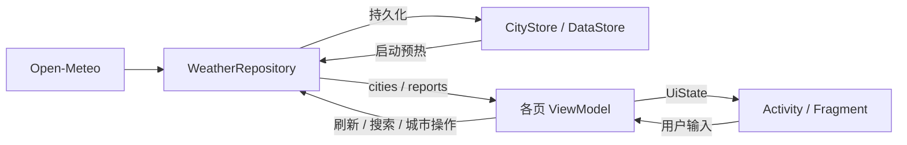

# 氢天气：设计与实现

本文说明当前 v1.3 的实现与约束。运行和操作见 [中文 README](../README.zh-CN.md)，待修复问题见 [审查记录](REVIEW.md)。依赖版本以 [版本目录](../gradle/libs.versions.toml) 和 [模块构建配置](../app/build.gradle.kts) 为准。

## 0. 核心决策

| 决策 | 当前实现 | 原因 |
| --- | --- | --- |
| D1：数据源 | Open-Meteo Forecast / Air Quality / Geocoding | 无需 API Key，支持当前页面所需数据 |
| D2 / D3：厂商接口 | 不接入 heytap 与 weather.1plus.io | 非公开接口，鉴权和城市标识不可控 |
| D4：网络与 JSON | Retrofit + Gson，三个域名共享 OkHttpClient | 运行时解析，构建配置简单 |
| D5 / D6：存储与注入 | DataStore Preferences + 手写 AppContainer | 当前数据量与依赖图较小 |
| D7 / D8：定位与首启 | 系统 LocationManager；不预置默认城市 | 不依赖 GMS，拒绝定位后可手动选城 |
| D9 / D10：预报与主页 | 应用内 15 天页；ViewPager2 多城市页，共用一个背景 | 复用天气缓存，避免每个城市页绘制全屏动画 |
| D11：功能范围 | 预警、视频、小部件、分享、反馈、设置暂未实现 | 当前聚焦天气展示与动画复刻 |

## 1. 数据源

### 1.1 Open-Meteo 接口

| 域名与路径 | 用途 | 主要参数 |
| --- | --- | --- |
| `api.open-meteo.com/v1/forecast` | 实况、逐时、逐日、日出日落 | `timezone=auto`、`forecast_days=16`、`wind_speed_unit=kmh` |
| `air-quality-api.open-meteo.com/v1/air-quality` | PM2.5 和 US AQI | `current=pm2_5,us_aqi`；US AQI 当前未展示 |
| `geocoding-api.open-meteo.com/v1/search` | 城市搜索 | `count=10`、`language=zh`、`format=json` |

请求字段集中在 [OpenMeteoApi.kt](../app/src/main/java/com/sugar/weather/data/remote/OpenMeteoApi.kt)。能见度来自当前整点的 `hourly.visibility`，由米换算为 km。

天气数据采用 CC BY 4.0，应用关于页提供署名。免费服务的非商业限制与配额以 [官方条款](https://open-meteo.com/en/terms) 和 [定价](https://open-meteo.com/en/pricing) 为准。

### 1.1.1 模型选择与每日天气

坐标落在北纬 18°–54°、东经 73°–135°时，并行发起以下请求：

- `best_match`：今天起 16 天，是整个刷新成功的必要条件。
- `models=cma_grapes_global`、`forecast_days=5`：今天起 5 天，失败时忽略。
- Air Quality：失败时沿用上一次 PM2.5；没有旧值则显示“—”。

CMA 的实况、时区、观测时间优先；逐日按日期、逐时按时间合并，同一条目 CMA 优先。**“前 5 天”包含今天**：即今天至第 4 天后，剩余 11 个日期来自 `best_match`。该包围盒会覆盖邻国部分地区，只表达模型偏好，不保证预测准确率。

`daily.weather_code` 表示当天最严重的天气。当前实现改为聚合城市本地自然日 **`[00:00, 24:00)`** 的逐小时数据；模型选择不保证优于其他模型，也不等同地方气象台的成品预报。

1. 晴与少云等先归类后统计。图标优先降水或雾等现象，同类取主导强度；雷暴、冰雹、冻雨等特殊现象优先保留。
2. `summaryText` 是首页与 15 天页共用的过程摘要，如“阴转小雨”“小雨转小雪”；降水暂停又恢复可写“间歇小雨”，频繁雨雪变化写“雨雪交替”，不推断雨夹雪。
3. `conditionText` 补充凌晨 `[00:00, 08:00)`、白天 `[08:00, 20:00)`、夜间 `[20:00, 24:00)`；这些是 App 的展示窗口。仅短暂云量变化可简化，一小时降水和特殊现象仍保留；同类短时强降水补充在详情中。
4. 无小时数据时回退到 API 日天气码；旧缓存可用已有小时数据补齐摘要，不额外访问网络。保留模型原始日高低温，不混合平均；小时天气码的强度名称不代表按国内日累计量重新分级。
5. 首页天气文字在“转”前优先换行，不设最大行数或省略号；两个稳定天空阶段也保留转折。15 天页首行显示同一摘要，之后补充分时段描述，并观察仓库报告更新，避免停留在进入时的旧快照。

实现见 [DailyCondition.kt](../app/src/main/java/com/sugar/weather/data/DailyCondition.kt)。数据不足和模型误差仍可能影响雨雪判断；当前未引入降水量/概率阈值校准，也未根据其他 App 的结果修改模型数值。

### 1.2 heytap

不使用 `news.heytapdownload.com` 的天气页面及其内部接口。页面使用厂商内部 `city_id`，没有可依赖的公开城市转换接口、文档或服务承诺；首页按钮改为打开应用内预报页。

### 1.3 weather.1plus.io

不依赖原版一加天气后端。历史静态分析显示它需要鉴权，当前项目未接入，也不将其作为失败兜底。

### 1.4 更换数据源

网络调用集中在 `WeatherRepository`，请求定义和 DTO 位于 `data/remote/`，转换位于 `WeatherMapper.kt`。更换服务主要影响这些位置；还需核对时区、单位、天气码、缺失值和缓存兼容性，不能假定只替换 DTO 即可完成。

## 2. 技术选型

### 2.1 网络、JSON 与 Kotlin

使用 Retrofit 3.0.0、Gson 2.13.1 和 OkHttp 4.12.0。三个 Retrofit 实例共用连接池；连接超时 10 秒、读取超时 15 秒，HTTP BASIC 日志仅在 debug 构建启用。

项目使用 AGP 内置 Kotlin，未引入序列化或注解处理插件，这是当前项目的简化选择。不能据此认定 AGP 9 不支持所有 Kotlin 编译器插件或 KSP；官方内置 Kotlin 迁移指南明确建议将不兼容的 `kotlin-kapt` 迁移到 KSP，具体插件需按其版本验证。见 [官方迁移说明](https://developer.android.com/build/migrate-to-built-in-kotlin)。

### 2.2 本地存储

`CityStore` 封装所有 DataStore 读写，View 层不直接访问存储。

| Key | 内容 | 失败处理 |
| --- | --- | --- |
| `city_list_v1` | `List<City>` 的 JSON | 读取或解析失败时回退空列表 |
| `weather_cache_{cityId}` | `CachedWeather(report, fetchedAtMillis)` 的 JSON | 无法读取或解析时忽略该缓存 |

日期时间使用 ISO 字符串适配器，避免 Gson 反射序列化 `java.time` 内部字段。启动时异步加载天气缓存到内存 `reports`，不会覆盖已更新条目；页面先等待预热完成，再判断是否需要刷新。

城市去重、定位城市置顶、排序归一化由 `WeatherRepository` 负责。`CityStorage` 定义持久化边界，`CityStore.updateCities` 在同一 `DataStore.edit` 中读改写，并清理被移除城市的天气缓存。仓库以同一个 Mutex 协调所有城市修改、缓存预热和天气提交，避免定位、添加、排序与删除互相覆盖。网络请求在锁外执行。

### 2.3 依赖注入

`WeatherApplication` 持有 `AppContainer`，提供 `CityStore`、三个网络接口、`WeatherRepository` 和 `LocationDataSource`。仓库的缓存预热和共享流使用进程级 IO 协程作用域；各页面通过 ViewModel 使用仓库。

### 2.4 定位

- FINE 或 COARSE 任一权限已授权即可尝试定位；没有权限则返回 `Denied`。
- 仅使用已启用的 NETWORK / GPS provider；5 分钟内的最后位置可直接使用，不再检查其精度。
- 无新鲜位置时监听更新，接受首个精度 ≤100 m 的位置，10 秒超时后返回 `Unavailable`，并注销监听。
- `MainActivity` 调用系统 Geocoder，以 `locality → subAdminArea → adminArea` 命名；失败时沿用已有名称或显示“我的位置”。Geocoder 可能使用系统提供方的网络服务。
- 已存在定位城市时，当前启动逻辑不会再次获取其坐标；位置刷新及仅有大致位置权限的 100 m 门槛都需要改进。

定位城市按数据规则固定在首位，不可删除或拖动。管理页按 `isLocated` 判断，纯手动列表的首项仍可排序、删除。

## 3. 15 天天气预报

`FifteenDayActivity` 接收城市 id；`FifteenDayViewModel` 经 `cachedOrRefresh` 获取报告。30 分钟内的缓存直接复用；无缓存或过期时请求，失败则回退旧报告。

Forecast 请求今天起 16 天，详情页按城市时区的当前日期过滤，只显示今天之后最多 15 条；只有日期确为次日时标为“明天”。缺少有效日期时列表更短；无缓存且失败，或旧缓存已没有未来预报时，显示说明和重试入口。

## 4. WMO 天气码与场景

完整中文文案以 [WeatherCodes.kt](../app/src/main/java/com/sugar/weather/data/WeatherCodes.kt) 为准，图标由 [WeatherIcons.kt](../app/src/main/java/com/sugar/weather/ui/weather/WeatherIcons.kt) 映射。

| WMO code | 场景 |
| --- | --- |
| 0、1 | `SUNNY` |
| 2 / 3 | `CLOUDY` / `OVERCAST` |
| 45、48 | `FOG` |
| 51、53、55、56、57、61 | `LIGHT_RAIN` |
| 63、66、67、80、81 | `RAIN` |
| 65、82 | `HEAVY_RAIN` |
| 71、77、85 | `LIGHT_SNOW` |
| 73、75、86 | `SNOW` |
| 95 | `THUNDER` |
| 96、99 | `HAIL` |
| 其他值 | `CLOUDY`，文案“多云” |

`HAZE`、`SANDSTORM`、`SLEET`、`STORM` 当前没有自动映射，只能调试选择。15 种场景均保留，不能因未自动选中就当作闲置实现删除。

实况昼夜取 `current.is_day`；没有实况时部分状态按设备时钟估算 19:00–06:00 为夜间，空城市状态默认晴天日间。逐日图标使用昼间样式；逐时图标根据对应日期的日出、日落选择昼夜。

## 5. 数值展示

### 5.1 PM2.5 分档

PM2.5 以 μg/m³ 为单位；阈值依次为 35、75、115、150、250，对应“优、良、轻度污染、中度污染、重度污染、严重污染”。缺失显示“—”。

这些阈值参考 HJ 633-2012 的 PM2.5 24 小时均值限值，但当前输入为接口的当前 PM2.5，且未综合其他污染物。该文字只是浓度近似分档，**不能当作完整中国 AQI 或官方空气质量结论**。

### 5.2 紫外线

使用当日日预报的 `uv_index_max`，区间 `<3 / <5 / <7 / <10 / ≥10` 对应“最弱 / 弱 / 中等 / 强 / 很强”；缺失显示“—”。这不是当前时刻的紫外线实况。

### 5.3 风向

角度归一化到 `[0,360)`，按 `round(deg / 22.5) mod 16` 映射 16 方位；风速小于 0.5 km/h 时显示“静风”。

### 5.4 格式与缺失值

温度四舍五入为整数，今日高低温为 `16/3°C`；PM2.5、湿度、风速、能见度保留 1 位小数，气压取整数。固定公制单位。

Mapper 在实况缺气温或天气码时舍弃整个实况块；部分其他缺失字段目前回退为 0，可能被误读为真实数值，后续应改为可空值和“—”。

## 6. 页面与动画

### 6.1 页面职责

| 页面 | 实现 | 主要状态 |
| --- | --- | --- |
| 多城市主页 | `MainActivity` + `CityPagesAdapter` | 页序、头部、背景、调试、姿态 |
| 单城市内容 | `WeatherFragment` + `WeatherViewModel` | 加载 / 内容 / 错误、日报、逐时、详情卡 |
| 城市管理 | `CityManageActivity` + `CityManageViewModel` | 城市卡、批量刷新、多选、排序与删除提交 |
| 城市搜索 | `CitySearchActivity` + `CitySearchViewModel` | 输入、结果、热门城市、添加事件 |
| 15 天预报 | `FifteenDayActivity` + `FifteenDayViewModel` | 日期列表、加载与重试 |
| 关于与离线文档 | `AboutActivity` + `DocumentActivity` | 版本、入口、本地读取与失败重试 |

### 6.1.1 UI 排版规范

尺寸集中在 `values/dimens.xml`，工具栏和图标样式位于 `values/styles.xml`：

| 项目 | 约定 |
| --- | --- |
| 页面左右边距 | 16dp，额外叠加刘海 / 侧边系统栏安全区，与 CollageWorkshop 的普通窗口规格一致 |
| 组件间距 | 以 8 / 16 / 24 / 32dp 为主，分组内部 16dp |
| 触摸目标 | 返回、清空、首页动作至少 48 × 48dp，图形通常 24dp |
| 内容分组 | 天气页使用 24dp 圆角浅色描边和半透明深色底，保留动画可见性 |
| 字号层级 | 实况 88sp、首页城市 20sp、工具栏 18sp、文档与入口正文 14sp、辅助信息 11–13sp |
| 安全区 | 背景铺满窗口；工具栏避让状态栏，列表末项避让导航栏，搜索同时避让键盘 |

View 安全区统一由 `ui/WindowInsets.kt` 处理，以 XML 原始 padding 为基准，重复派发不累加；不消费 insets，兼容 Android 10 的兄弟视图分发。

全局主题继承 `Theme.Material3.DayNight.NoActionBar`，参照 CollageWorkshop 的湖蓝主色与 M3 色彩角色设置。`values/colors.xml` 与 `values-night/colors.xml` 分别提供表面、文字、容器、描边与错误色；普通页面的工具栏、正文和系统栏图标随明暗模式切换。天气场景色独立于主题色，搜索页通过 `ThemeOverlay.Weather.Forecast` 为 M3 输入框与 Assist Chip 提供固定深色角色。

所有确认弹窗统一使用 `MaterialAlertDialogBuilder` 和 `ThemeOverlay.Material3.MaterialAlertDialog`，保留 M3 默认 28dp 圆角及标题 / 正文 / 操作区排版。动画调试弹窗使用自身主题上下文创建自定义内容，场景选择为 M3 Exposed Dropdown Menu，开关为 MaterialSwitch。按钮、加载指示器、城市添加 FAB、搜索输入和热门城市标签均使用 M3 组件或其样式，不再显式引用 M2 样式。

### 6.2 天气首页

全屏 `WeatherBackdropView` 位于透明 ViewPager2 下方，仅绘制当前城市。头部显示定位标记、城市名、更新时间、城市管理和溢出菜单；预警图标隐藏占位。

温度区起点约在当前可用窗口高度的 36% 处，布局变化时重新计算；短窗口至少保留头部及 32dp 留白，额外留白最多 280dp。后续依次为 6 天日报 / 曲线 / 15 天按钮分组、24 小时预报分组、8 项双列详情卡。日报按城市当前日期过滤，不把旧缓存的观测日标成今天。

每个城市页在滚动内容下方放置不接收触摸的黑色遮罩，上滑约 35% 窗口高度时达到 14% 暗度（渐变距离至少 160dp）；回顶恢复透明。遮罩仅压暗动画，文字、按钮和顶部头部保持亮度；布局变化、页面恢复及加载/错误态切换时按当前滚动位置重算，不改变场景或帧循环。

逐时窗口从报告观测时间的下一整点开始。窗口内的日出 / 日落使用完整日期时间排序，包含次日事件；事件温度取其时刻或之后第一个整点。SwipeRefreshLayout 仅承载滚动视图，加载 / 错误覆盖层由外层 FrameLayout 布局。

`WeatherSwipeRefreshLayout` 按系统 touch slop 锁定起手方向：纵向拖动保留给 NestedScrollView / 刷新链，普通内容横向拖动交给 ViewPager2；从逐时列表起手且仍可滚动时优先保留小时横滑，到边界后可交给城市分页。日报完整铺开，禁止自身纵向滚动；两份内部 RecyclerView 不参与嵌套滚动，只有外层 NestedScrollView 提交纵向未消费距离。刷新判断显式读取正文能否继续向上滚动；刷新圈按 `paddingTop` 避让状态栏和固定标题，使用主题主色箭头与容器底色，重新布局不丢失进行中标志。`WeatherUiState.isRefreshing` 持有持续刷新状态，成功、失败或任务取消均复位，一次性事件仅保留失败提示。

### 6.3 日报与温度曲线

日报使用 `GridLayoutManager(span=6)`；`WeatherTrendView` 预计算高低温路径、渐变和标签，绘制阶段复用对象。日报与曲线具有相同左右边界，始终按 6 列中心对齐；缺日时不向空列外推。相同数据不重算，数据变化或清空后立即请求重绘。

### 6.4 搜索

输入经 300 ms 防抖后请求；新查询取消旧搜索，过期结果不覆盖当前输入。结果按人口非空且从大到小排序，再比较名称长度和名称。短中文名可能只命中同名村镇，因此提示输入全名。

12 个热门城市使用内置坐标，不依赖搜索网络。添加时按 id 或经纬度差各小于 `1e-4°` 去重。仓库返回实际保留的 City，重复地点的搜索结果使用已有标识回传首页，避免切换不存在的城市。

### 6.5 城市卡

城市管理 ViewModel 创建时，等待非空城市列表后批量刷新一次，并发上限为 4。`CitySelection` 按城市标识记录选择，通过 `SavedStateHandle` 恢复模式与标识；列表回流时过滤失效项和定位城市，天气刷新不重置选择。

长按卡片或点击编辑进入多选；蓝色 2dp 描边与顶栏数量来自同一状态。关闭或系统返回退出选择，取消最后一项仍保留模式，空选择禁用删除。确认对话框捕获标识快照；提交期间锁定交互，失败保留选择并提示重试。

卡片右侧手柄长按触发拖拽，单击提供上下移动菜单，便于无障碍操作。卡片长按不再启动拖拽。多选期间禁用拖拽 / 左滑，普通模式左滑同样先确认再删除。拖拽期间暂缓天气列表回流，松手后提交最终顺序；真正的定位城市不可拖删，手动首项不受限制。

每张卡独立持有天气场景，更新帧率上限 24 fps，实际频率取决于屏幕刷新率。传入场景的显示密度乘 `0.35`，缩小粒子尺寸和速度；**粒子数量没有减少**。View 脱离窗口或窗口不可见时暂停。

### 6.6 图标与资源

页面图标使用 vector XML。原创“晴空轻云”标识用于关于页与 adaptive icon，并有独立单色前景供主题图标使用。最低 API 29 已支持 adaptive icon，旧版默认机器人 WebP 与旧关于页云图已移除。矢量稿、PNG、颜色与路径生成方式见[品牌资产说明](brand/README.md)。日夜共用 `values/themes.xml`，明暗色值分别在 `values/` 与 `values-night/` 中维护。

### 6.7 功能边界

暂未实现预警、视频、小部件、分享、反馈、设置或后台定时刷新。逐小时条与城市分页都使用横向手势；大屏、系统栏和字体放大仍需设备验证。

## 7. 关于页

展示原创 Logo、由 Gradle 生成的 `BuildConfig.VERSION_NAME`、作者薯格、GitHub 主页、抖音号及二维码、数据署名，以及协议、隐私、版本历史、帮助和组件说明入口。抖音入口沿用 CollageWorkshop 的公开二维码并支持主动复制账号；没有账号登录或阅读前的权限要求。

`DocumentActivity` 只接受 `LocalDocument` 枚举白名单中的文档，在 IO 线程读取包内 Markdown，再通过 Markwon 渲染。正文为 14sp、额外行距 2dp，标题使用 1.5 / 1.25 等倍率；读取失败可重试。`DocumentNavigation` 根据渲染后的 HeadingSpan 生成章节胶囊并高亮当前章节，右上角可回到顶部。

显式 Markdown 链接和裸网址统一经 `ui/ExternalLinks.kt`：仅允许 http(s)，显示目标域名和完整地址，用户确认后才启动浏览器。通过 AndroidX Browser 优先选择 Chrome Custom Tabs，其余支持标签页的浏览器次之，不可用时回退系统浏览器；没有 WebView，也不预先加载目标网页。

构建任务 `syncAppDocuments` 把 `docs/legal/`、根目录 `CHANGELOG.md`、`docs/USER_GUIDE.md` 和 `docs/THIRD_PARTY_NOTICES.md` 同步到生成的 assets。研发资料、Logo 导出和场景 MP4 不打包。正文只维护仓库版本，旧 `docs/PRIVACY.md` 为索引；当前应用展示中文，仓库另提供英文法律文本。

权限和数据传输见[隐私政策](legal/PRIVACY_POLICY.md)，文档维护方式见[文档索引](README.md)。

## 8. 分层与状态

### 8.1 分层约束

Activity / Fragment 负责绑定、系统栏、导航和输入转发；ViewModel 合成 UiState、处理刷新和格式化；Repository 协调网络、合并与存储。自定义 View 可消费领域模型用于绘制，但不直接访问网络或仓库。

### 8.2 状态流

各页面状态定义在相邻的 `*UiState.kt`，不在文档重复维护字段清单。`MainViewModel` 将高频 `tilt` 与低频 `pages / header / backdrop / sceneState` 分开，头部更新时间每 30 秒重算；这条 ticker 不发起网络刷新。

## 9. 数据流与刷新策略



| 触发点 | 当前行为 |
| --- | --- |
| 创建 / 恢复城市页 | 等待磁盘预热后检查，缓存缺失或超过 30 分钟时刷新；同一页内合并重复检查 |
| 下拉 / 错误页重试 | 强制刷新；同一 WeatherViewModel 内防止重入 |
| 创建城市管理 ViewModel | 非空列表批量刷新一次，并发 4 |
| 打开 15 天页 | 复用 30 分钟内缓存；过期则刷新，失败回退旧报告中仍有效的未来日期 |
| 既有定位城市 | 当前仍不重新获取定位坐标，见审查记录 |
| 后台 | 不定时请求天气 |

`best_match` 失败则保留旧报告并提示；没有缓存时显示错误和重试。CMA / 空气质量为可降级请求。协程取消应向上传播；网络错误经 `WeatherDataException` 包装。缓存写入失败不影响内存展示。DTO 转换与小时聚合在 Default dispatcher 执行，缓存序列化 / 写入在 IO dispatcher 执行。

当前没有仓库级别的同城市请求合并；城市页、管理页、15 天页可能同时请求相同城市。删除城市会在一次事务内移除条目及磁盘天气，随后过滤内存 `reports`。天气请求完成后在同一城市互斥区重新读取存储，核对城市仍存在且坐标、添加时间未变化，再提交内存和磁盘；迟到请求不能恢复已删除城市。请求本身不因删除主动取消，网络工作量优化仍可后续评估。

## 10. 开发与调参入口

### 10.1 构建与验证

依赖版本由 `gradle/libs.versions.toml` 管理；Android 配置在 `app/build.gradle.kts`。当前 release 关闭优化，启用 R8 前需检查 Gson 网络 DTO 与本地缓存模型的反射保留规则，并验证旧缓存兼容性。

```bash
sh ./gradlew :app:lintDebug :app:testDebugUnitTest :app:assembleDebug
```

### 10.2 实现位置

| 目录 / 文件 | 职责 |
| --- | --- |
| `data/remote/`、`WeatherMapper.kt` | 请求、DTO、领域模型转换 |
| `WeatherRepository.kt`、`CityStore.kt` | 合并、城市规则、内存与磁盘缓存 |
| `DailyCondition.kt`、`WeatherCodes.kt`、`WeatherFormat.kt` | 天气聚合、映射与格式化 |
| `ui/` | ViewModel、页面状态、页面与列表适配器 |
| `view/` | 全屏 / 卡片动画、温度曲线、详情单元 |
| `scene/`、`sensor/` | 天气场景、姿态模型、系统传感器封装 |

### 10.3 调参

| 内容 | 入口 |
| --- | --- |
| 晴天光晕、云朵、弧线、视差 | `scene/SunnySceneConfig.kt` |
| 场景背景色 | `scene/SceneType.kt` |
| 云团、雾、霾、沙尘参数 | 对应 `*Scene.kt` 的配置数组 / 常量 |
| 雨雪强度、数量、尺寸和速度 | `RainScene.kt`、`SnowScene.kt` |
| 城市卡帧率和尺寸缩放 | `view/WeatherCardBackdropView.kt` |
| 温度曲线样式 | `view/WeatherTrendView.kt` |

全屏背景跟随 Choreographer 的屏幕刷新节奏，并未固定限为 60 fps；时间步长最多 30 ms。姿态传感器在主页 `onStart / onStop` 注册 / 注销；全屏帧循环在 `onResume / onPause` 启停。

晴天白天将设备俯仰绝对值 0°～90° 映射到视觉俯仰 70°～90°，平放时保留彩色光晕及云朵；竖直构图、夜景与其他场景不变。该映射只在 SunnyScene 内生效，不更改传感器原值或调试读数，最低视觉角由 `DAY_MIN_VISIBLE_PITCH_DEG` 调整。

## 11. 已知问题与验证范围

2026-11-06 的文档、资源和代码审查见 [REVIEW.md](REVIEW.md)，其中区分了已经清理的项目、可复现逻辑问题和待设备验证的优化建议。

较早 v1.2 的构建、28 个 JVM 测试和 Lint 结果集中记录在[审查记录](REVIEW.md#验证记录)。当时未运行模拟器或设备，新增多选手势、TalkBack、图标遮罩与字体放大仍需设备验收；没有据此宣称定位、性能或大屏适配已完成。

后续 16dp 留白、文档导航、作者入口、Custom Tabs 和晴天平放可见性改动仅做源码与资源静态核查，未运行 Gradle 构建、测试或设备验证；上述较早的 v1.2 验证结果不覆盖这些改动。

v1.3 最初的全天摘要、两页同步、完整换行和上滑压暗只做静态核查；本轮刷新与 M3 迁移后，当前工作区已通过 Debug 构建、42 个 JVM 测试（含 23 个全天气聚合用例）与 Lint（0 错误、37 条警告）。停止测试机操作前完成的 6 个设备测试只覆盖隔离内容手势和明暗主题创建，不能代表真实联网刷新或完整视觉验收；执行细节见审查记录。按用户当前要求不再调用测试机，窄屏 / 大字体、TalkBack、实际页面视觉和性能仍待维护者确认。
