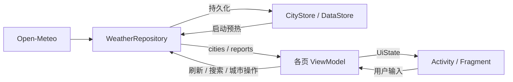

# 氢天气：设计与实现

本文说明当前 v1.1 的实现与约束。运行和操作见 [中文 README](../README.zh-CN.md)，待修复问题见 [审查记录](REVIEW.md)。依赖版本以 [版本目录](../gradle/libs.versions.toml) 和 [模块构建配置](../app/build.gradle.kts) 为准。

## 0. 核心决策

| 决策 | 当前实现 | 原因 |
| --- | --- | --- |
| D1：数据源 | Open-Meteo Forecast / Air Quality / Geocoding | 无需 API Key，支持当前页面所需数据 |
| D2 / D3：厂商接口 | 不接入 heytap 与 weather.1plus.io | 非公开接口，鉴权和城市标识不可控 |
| D4：网络与 JSON | Retrofit + Gson，三个域名共享 OkHttpClient | 运行时解析，构建配置简单 |
| D5 / D6：存储与注入 | DataStore Preferences + 手写 AppContainer | 当前数据量与依赖图较小 |
| D7 / D8：定位与首启 | 系统 LocationManager；不预置默认城市 | 不依赖 GMS，拒绝定位后可手动选城 |
| D9 / D10：预报与主页 | 应用内 15 天页；ViewPager2 多城市页，共用一个背景 | 复用天气缓存，避免每个城市页绘制全屏动画 |
| D11：功能范围 | 预警、视频、小部件、分享、反馈、设置暂未实现 | 当前聚焦天气展示与动画复刻 |

## 1. 数据源

### 1.1 Open-Meteo 接口

| 域名与路径 | 用途 | 主要参数 |
| --- | --- | --- |
| `api.open-meteo.com/v1/forecast` | 实况、逐时、逐日、日出日落 | `timezone=auto`、`forecast_days=16`、`wind_speed_unit=kmh` |
| `air-quality-api.open-meteo.com/v1/air-quality` | PM2.5 和 US AQI | `current=pm2_5,us_aqi`；US AQI 当前未展示 |
| `geocoding-api.open-meteo.com/v1/search` | 城市搜索 | `count=10`、`language=zh`、`format=json` |

请求字段集中在 [OpenMeteoApi.kt](../app/src/main/java/com/sugar/weather/data/remote/OpenMeteoApi.kt)。能见度来自当前整点的 `hourly.visibility`，由米换算为 km。

天气数据采用 CC BY 4.0，应用关于页提供署名。免费服务的非商业限制与配额以 [官方条款](https://open-meteo.com/en/terms) 和 [定价](https://open-meteo.com/en/pricing) 为准。

### 1.1.1 模型选择与白天天气

坐标落在北纬 18°–54°、东经 73°–135°时，并行发起以下请求：

- `best_match`：今天起 16 天，是整个刷新成功的必要条件。
- `models=cma_grapes_global`、`forecast_days=5`：今天起 5 天，失败时忽略。
- Air Quality：失败时沿用上一次 PM2.5；没有旧值则显示“—”。

CMA 的实况、时区、观测时间优先；逐日按日期、逐时按时间合并，同一条目 CMA 优先。**“前 5 天”包含今天**：即今天至第 4 天后，剩余 11 个日期来自 `best_match`。该包围盒会覆盖邻国部分地区，只表达模型偏好，不保证预测准确率。

`daily.weather_code` 表示当天最严重的天气。当前实现改为聚合城市本地时间 **`[08:00, 20:00)`** 的逐小时数据：

1. 出现次数最多的天气码用于首页短文案和图标；平票按降水优先、雪优先于雨等规则处理。
2. 按连续天气类别分段，少于 2 个小时样本的段不单独生成转折；最多保留首段、最长中间段、末段。
3. 没有白天样本时回退到 API 日天气码；旧缓存缺少 `conditionText` 时回退到天气码文案。

实现见 [DailyCondition.kt](../app/src/main/java/com/sugar/weather/data/DailyCondition.kt)。当前首尾同类时会漏掉中间转折，已记录为待修复问题。

### 1.2 heytap

不使用 `news.heytapdownload.com` 的天气页面及其内部接口。页面使用厂商内部 `city_id`，没有可依赖的公开城市转换接口、文档或服务承诺；首页按钮改为打开应用内预报页。

### 1.3 weather.1plus.io

不依赖原版一加天气后端。历史静态分析显示它需要鉴权，当前项目未接入，也不将其作为失败兜底。

### 1.4 更换数据源

网络调用集中在 `WeatherRepository`，请求定义和 DTO 位于 `data/remote/`，转换位于 `WeatherMapper.kt`。更换服务主要影响这些位置；还需核对时区、单位、天气码、缺失值和缓存兼容性，不能假定只替换 DTO 即可完成。

## 2. 技术选型

### 2.1 网络、JSON 与 Kotlin

使用 Retrofit 3.0.0、Gson 2.13.1 和 OkHttp 4.12.0。三个 Retrofit 实例共用连接池；连接超时 10 秒、读取超时 15 秒，HTTP BASIC 日志仅在 debug 构建启用。

项目使用 AGP 内置 Kotlin，未引入序列化或注解处理插件，这是当前项目的简化选择。不能据此认定 AGP 9 不支持所有 Kotlin 编译器插件或 KSP；官方内置 Kotlin 迁移指南明确建议将不兼容的 `kotlin-kapt` 迁移到 KSP，具体插件需按其版本验证。见 [官方迁移说明](https://developer.android.com/build/migrate-to-built-in-kotlin)。

### 2.2 本地存储

`CityStore` 封装所有 DataStore 读写，View 层不直接访问存储。

| Key | 内容 | 失败处理 |
| --- | --- | --- |
| `city_list_v1` | `List<City>` 的 JSON | 读取或解析失败时回退空列表 |
| `weather_cache_{cityId}` | `CachedWeather(report, fetchedAtMillis)` 的 JSON | 无法读取或解析时忽略该缓存 |

日期时间使用 ISO 字符串适配器，避免 Gson 反射序列化 `java.time` 内部字段。启动时异步加载全部天气缓存到内存 `reports`，不会覆盖已更新的内存条目。

城市去重、定位城市置顶、排序归一化由 `WeatherRepository` 负责。列表的“读—改—写”目前并非同一个 DataStore 事务；并发修改风险见审查记录。

### 2.3 依赖注入

`WeatherApplication` 持有 `AppContainer`，提供 `CityStore`、三个网络接口、`WeatherRepository` 和 `LocationDataSource`。仓库的缓存预热和共享流使用进程级 IO 协程作用域；各页面通过 ViewModel 使用仓库。

### 2.4 定位

- FINE 或 COARSE 任一权限已授权即可尝试定位；没有权限则返回 `Denied`。
- 仅使用已启用的 NETWORK / GPS provider；5 分钟内的最后位置可直接使用，不再检查其精度。
- 无新鲜位置时监听更新，接受首个精度 ≤100 m 的位置，10 秒超时后返回 `Unavailable`，并注销监听。
- `MainActivity` 调用系统 Geocoder，以 `locality → subAdminArea → adminArea` 命名；失败时沿用已有名称或显示“我的位置”。Geocoder 可能使用系统提供方的网络服务。
- 已存在定位城市时，当前启动逻辑不会再次获取其坐标；位置刷新及仅有大致位置权限的 100 m 门槛都需要改进。

定位城市按数据规则固定在首位，不可删除或拖动。当前城市管理 UI 错把所有首项都锁定，属于实现缺陷，详见审查记录。

## 3. 15 天天气预报

`FifteenDayActivity` 接收城市 id；`FifteenDayViewModel` 经 `cachedOrRefresh` 获取报告。存在内存缓存时直接使用，无缓存才请求；未单独判断缓存是否过期。

Forecast 请求今天起 16 天，详情页使用 `daily.drop(1).take(15)`，即跳过报告第一条，最多展示 15 条。响应缺少有效日期时列表可能更短；旧缓存跨日后也仍按原报告顺序展示，不能保证第一条始终是实际“明天”。失败时显示重试入口。

## 4. WMO 天气码与场景

完整中文文案以 [WeatherCodes.kt](../app/src/main/java/com/sugar/weather/data/WeatherCodes.kt) 为准，图标由 [WeatherIcons.kt](../app/src/main/java/com/sugar/weather/ui/weather/WeatherIcons.kt) 映射。

| WMO code | 场景 |
| --- | --- |
| 0、1 | `SUNNY` |
| 2 / 3 | `CLOUDY` / `OVERCAST` |
| 45、48 | `FOG` |
| 51、53、55、56、57、61 | `LIGHT_RAIN` |
| 63、66、67、80、81 | `RAIN` |
| 65、82 | `HEAVY_RAIN` |
| 71、77、85 | `LIGHT_SNOW` |
| 73、75、86 | `SNOW` |
| 95 | `THUNDER` |
| 96、99 | `HAIL` |
| 其他值 | `CLOUDY`，文案“多云” |

`HAZE`、`SANDSTORM`、`SLEET`、`STORM` 当前没有自动映射，只能调试选择。15 种场景均保留，不能因未自动选中就当作闲置实现删除。

实况昼夜取 `current.is_day`；没有实况时部分状态按设备时钟估算 19:00–06:00 为夜间，空城市状态默认晴天日间。逐时、逐日图标统一使用昼间样式。

## 5. 数值展示

### 5.1 PM2.5 分档

PM2.5 以 μg/m³ 为单位；阈值依次为 35、75、115、150、250，对应“优、良、轻度污染、中度污染、重度污染、严重污染”。缺失显示“—”。

这些阈值参考 HJ 633-2012 的 PM2.5 24 小时均值限值，但当前输入为接口的当前 PM2.5，且未综合其他污染物。该文字只是浓度近似分档，**不能当作完整中国 AQI 或官方空气质量结论**。

### 5.2 紫外线

使用当日日预报的 `uv_index_max`，区间 `<3 / <5 / <7 / <10 / ≥10` 对应“最弱 / 弱 / 中等 / 强 / 很强”；缺失显示“—”。这不是当前时刻的紫外线实况。

### 5.3 风向

角度归一化到 `[0,360)`，按 `round(deg / 22.5) mod 16` 映射 16 方位；风速小于 0.5 km/h 时显示“静风”。

### 5.4 格式与缺失值

温度四舍五入为整数，今日高低温为 `16/3°C`；PM2.5、湿度、风速、能见度保留 1 位小数，气压取整数。固定公制单位。

Mapper 在实况缺气温或天气码时舍弃整个实况块；部分其他缺失字段目前回退为 0，可能被误读为真实数值，后续应改为可空值和“—”。

## 6. 页面与动画

### 6.1 页面职责

| 页面 | 实现 | 主要状态 |
| --- | --- | --- |
| 多城市主页 | `MainActivity` + `CityPagesAdapter` | 页序、头部、背景、调试、姿态 |
| 单城市内容 | `WeatherFragment` + `WeatherViewModel` | 加载 / 内容 / 错误、日报、逐时、详情卡 |
| 城市管理 | `CityManageActivity` + `CityManageViewModel` | 城市卡、批量刷新 |
| 城市搜索 | `CitySearchActivity` + `CitySearchViewModel` | 输入、结果、热门城市、添加事件 |
| 15 天预报 | `FifteenDayActivity` + `FifteenDayViewModel` | 日期列表、加载与重试 |
| 关于 | `AboutActivity` | 静态内容，无 ViewModel |

### 6.2 天气首页

全屏 `WeatherBackdropView` 位于透明 ViewPager2 下方，仅绘制当前城市。头部显示定位标记、城市名、更新时间、城市管理和溢出菜单；预警图标隐藏占位。

内容依次为约半屏留白、温度块、6 天日报、温度曲线、15 天按钮、24 小时预报、8 项双列详情卡。逐时窗口从报告观测时间的下一整点开始，当前只尝试插入报告首日的日出 / 日落；跨日窗口可能漏掉次日事件。

### 6.3 日报与温度曲线

日报使用 `GridLayoutManager(span=6)`；`WeatherTrendView` 预计算高低温路径、渐变和标签，绘制阶段复用对象。数据完整时按 6 列中心对齐；不足 6 天时曲线按实际条目数分配宽度，存在与固定日报列宽错位的风险。

### 6.4 搜索

输入经 300 ms 防抖后请求；新查询取消旧搜索，过期结果不覆盖当前输入。结果按人口非空且从大到小排序，再比较名称长度和名称。短中文名可能只命中同名村镇，因此提示输入全名。

12 个热门城市使用内置坐标，不依赖搜索网络。添加时按 id 或经纬度差各小于 `1e-4°` 去重。搜索生成的稳定 id 与已有同坐标城市 id 可能不同，重复添加后的返回选择仍需改进。

### 6.5 城市卡

城市管理 ViewModel 创建时，等待非空城市列表后批量刷新一次，并发上限为 4。重排和删除通过仓库持久化。

每张卡独立持有天气场景，更新帧率上限 24 fps，实际频率取决于屏幕刷新率。传入场景的显示密度乘 `0.35`，缩小粒子尺寸和速度；**粒子数量没有减少**。View 脱离窗口或窗口不可见时暂停。

### 6.6 图标与资源

页面图标为手写 vector XML。启动图标的多密度 WebP 与自适应图标供系统选择，不能仅凭同名认定重复。日夜主题目前完全相同，统一使用 `values/themes.xml`。

### 6.7 功能边界

暂未实现预警、视频、小部件、分享、反馈、设置或后台定时刷新。逐小时条与城市分页都使用横向手势；大屏、系统栏和字体放大仍需设备验证。

## 7. 关于页

展示云朵图标、版本、更新日志、数据来源和隐私摘要；用户协议为占位。当前版本同时写在 Gradle、`AppContainer.APP_VERSION` 和更新日志文字中，发布时需同步，后续可统一版本来源。

权限和数据传输见 [隐私政策](PRIVACY.md)。

## 8. 分层与状态

### 8.1 分层约束

Activity / Fragment 负责绑定、系统栏、导航和输入转发；ViewModel 合成 UiState、处理刷新和格式化；Repository 协调网络、合并与存储。自定义 View 可消费领域模型用于绘制，但不直接访问网络或仓库。

### 8.2 状态流

各页面状态定义在相邻的 `*UiState.kt`，不在文档重复维护字段清单。`MainViewModel` 将高频 `tilt` 与低频 `pages / header / backdrop / sceneState` 分开，头部更新时间每 30 秒重算；这条 ticker 不发起网络刷新。

## 9. 数据流与刷新策略



| 触发点 | 当前行为 |
| --- | --- |
| 创建城市页 ViewModel | 内存无缓存或超过 30 分钟时刷新；磁盘预热异步进行，启动时仍可能多发请求 |
| 下拉 / 错误页重试 | 强制刷新；同一 WeatherViewModel 内防止重入 |
| 创建城市管理 ViewModel | 非空列表批量刷新一次，并发 4 |
| 打开 15 天页 | 有内存缓存直接使用，无缓存请求 |
| 返回已有城市页 / 既有定位城市 | 当前不会重新检查缓存 / 更新定位坐标 |
| 后台 | 不定时请求天气 |

`best_match` 失败则保留旧报告并提示；没有缓存时显示错误和重试。CMA / 空气质量为可降级请求。协程取消应向上传播；网络错误经 `WeatherDataException` 包装。缓存写入失败不影响内存展示。

当前没有仓库级别的同城市请求合并；城市页、管理页、15 天页可能同时请求相同城市。城市删除会清理磁盘天气缓存，但内存 `reports` 未同步移除，进行中的请求还可能重新写入。

## 10. 开发与调参入口

### 10.1 构建与验证

依赖版本由 `gradle/libs.versions.toml` 管理；Android 配置在 `app/build.gradle.kts`。当前 release 关闭优化，启用 R8 前需检查 Gson 网络 DTO 与本地缓存模型的反射保留规则，并验证旧缓存兼容性。

```bash
sh ./gradlew :app:lintDebug :app:testDebugUnitTest :app:assembleDebug
```

### 10.2 实现位置

| 目录 / 文件 | 职责 |
| --- | --- |
| `data/remote/`、`WeatherMapper.kt` | 请求、DTO、领域模型转换 |
| `WeatherRepository.kt`、`CityStore.kt` | 合并、城市规则、内存与磁盘缓存 |
| `DailyCondition.kt`、`WeatherCodes.kt`、`WeatherFormat.kt` | 天气聚合、映射与格式化 |
| `ui/` | ViewModel、页面状态、页面与列表适配器 |
| `view/` | 全屏 / 卡片动画、温度曲线、详情单元 |
| `scene/`、`sensor/` | 天气场景、姿态模型、系统传感器封装 |

### 10.3 调参

| 内容 | 入口 |
| --- | --- |
| 晴天光晕、云朵、弧线、视差 | `scene/SunnySceneConfig.kt` |
| 场景背景色 | `scene/SceneType.kt` |
| 云团、雾、霾、沙尘参数 | 对应 `*Scene.kt` 的配置数组 / 常量 |
| 雨雪强度、数量、尺寸和速度 | `RainScene.kt`、`SnowScene.kt` |
| 城市卡帧率和尺寸缩放 | `view/WeatherCardBackdropView.kt` |
| 温度曲线样式 | `view/WeatherTrendView.kt` |

全屏背景跟随 Choreographer 的屏幕刷新节奏，并未固定限为 60 fps；时间步长最多 30 ms。姿态传感器在主页 `onStart / onStop` 注册 / 注销；全屏帧循环在 `onResume / onPause` 启停。

## 11. 已知问题与验证范围

2026-11-06 的文档、资源和代码审查见 [REVIEW.md](REVIEW.md)，其中区分了已经清理的项目、可复现逻辑问题和待设备验证的优化建议。

本次通过 Debug 构建、Lint 和现有 6 个 JVM 测试；没有连接设备，因此没有新增真机手势、定位、大屏或帧耗时验证。Lint 通过仍有方向锁定、重复背景绘制、依赖版本等提示，不能据此认为所有行为正确。
