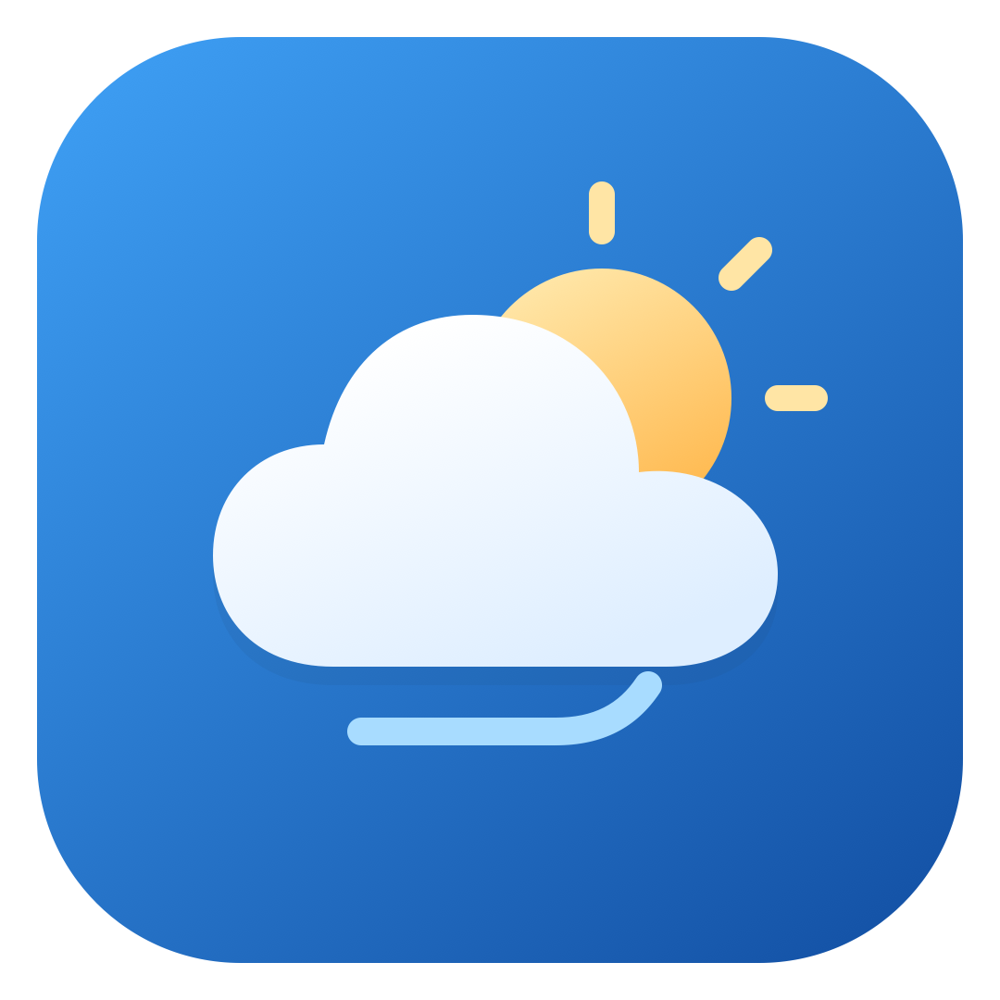

# 氢天气 Logo · 晴空轻云

2026-11-06 绘制。使用晴空蓝渐变、暖金太阳、轻云与一笔微风，呼应天气动画的轻盈感；没有使用原天气应用或 OnePlus 的 Logo、位图和字体素材。

## 可用文件

- [SVG 矢量稿](hydrogen-weather-logo.svg)：108 × 108 坐标、1080 × 1080 默认导出尺寸，适合继续编辑和缩放。
- [PNG 预览](hydrogen-weather-logo.png)：1080 × 1080，供浏览与分享；应用使用 vector XML。
- [生成脚本](../../tools/generate_brand_assets.py)：同一组路径生成 SVG、关于页图标、桌面前景、背景与单色图标。

## 色彩与留白

| 角色 | 色值 |
| --- | --- |
| 晴空蓝 | `#3D9DF2` → `#1452A6` |
| 暖金太阳 | `#FFE8AB` → `#FFB84D` |
| 轻云 | `#FFFFFF` → `#DEEEFF` |
| 微风 | `#A8DCFF` |

关于页展示完整圆角底板；桌面图标由系统决定圆形或其他遮罩。前景以中心点缩放至 88%，主要轮廓位于中央约 66dp 的安全范围内，避免裁切。Android 13+ 的主题图标使用独立单色资源。

项目最低支持 Android 10（API 29），系统已支持 adaptive icon，因此移除旧版 Android Studio 默认机器人 WebP 回退图，避免多密度配置选中旧图。

## 更新方式

运行 `python3 tools/generate_brand_assets.py` 更新矢量资源。PNG 是预览导出，修改路径后应重新导出并查看；在 macOS 上可用 `qlmanage -t -s 1080 -o /tmp docs/brand/hydrogen-weather-logo.svg` 生成预览，再复制到本目录。品牌图不额外改变项目的使用授权，也不表示任何厂商认可。
